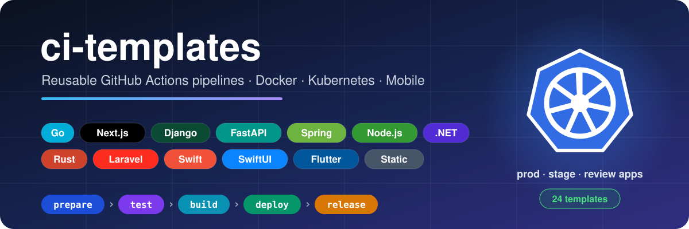
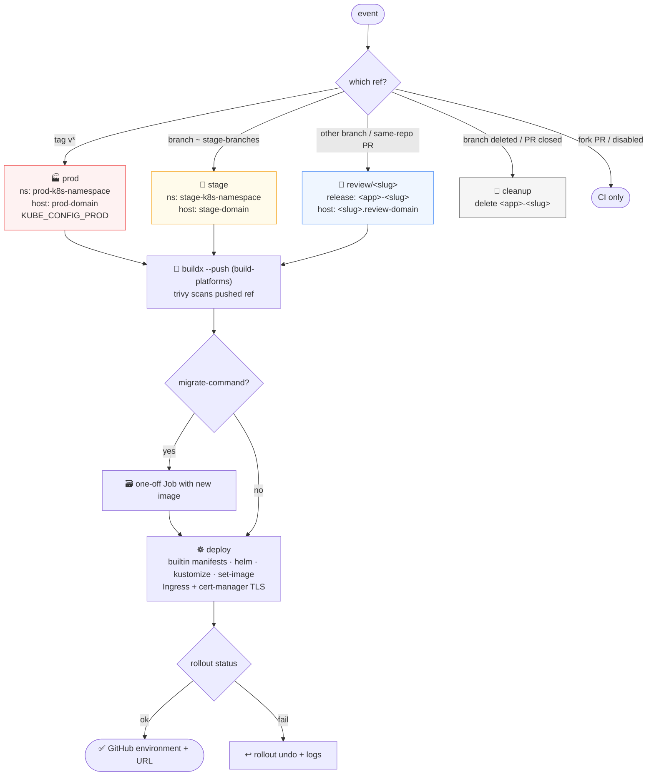
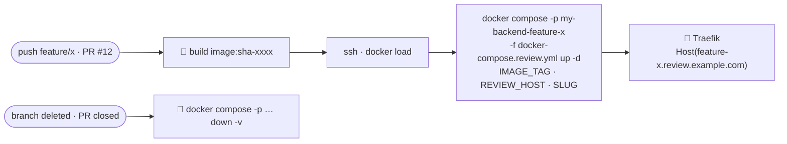
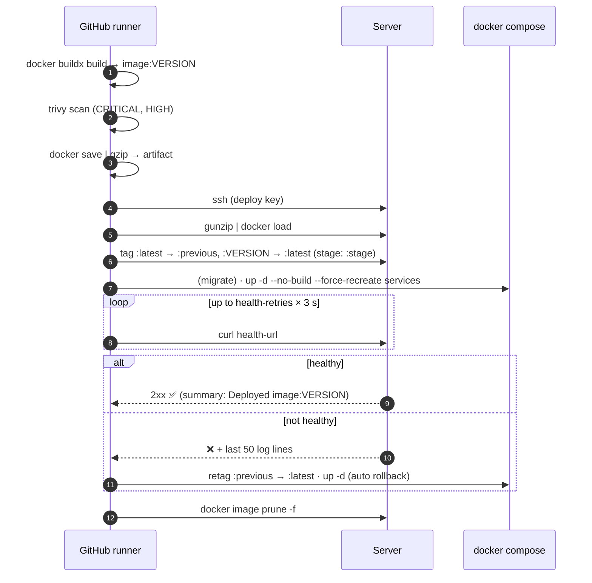

<p align="center">
  
</p>

<p align="center">
  
  
  
  
  
  
  
  
  
  
  
  
  
  
  
</p>

<p align="center">
  <b>One line in your repo → lint, test, build, scan, deploy over SSH <i>or</i> to Kubernetes, health-check and release.</b>
</p>

---

## 📚 Table of contents

- [What is this?](#-what-is-this)
- [Templates](#-templates)
- [How a pipeline flows](#-how-a-pipeline-flows)
- [What runs when](#-what-runs-when)
- [Turn stages on/off](#-turn-stages-onoff)
- [Quick start](#-quick-start)
  - [Go + Docker](#1-go--docker)
  - [Next.js + Docker](#2-nextjs--docker)
  - [Static site (Next.js export, Vite, …)](#3-static-site)
  - [Django + Docker](#4-django--docker)
  - [More Docker stacks](#5-more-docker-stacks)
  - [Kubernetes variants](#6-kubernetes-variants)
  - [iOS SwiftUI](#7-ios-swiftui)
  - [Flutter (Android)](#8-flutter-android)
- [Kubernetes](#-kubernetes)
- [Stage, review apps, rollback & PR coverage](#-stage-review-apps-rollback--pr-coverage)
- [App stores (Play / App Store)](#-app-stores)
- [Inputs reference](#-inputs-reference)
- [Secrets & variables](#-secrets--variables)
- [Server prerequisites](#-server-prerequisites)
- [Deploy under the hood](#-deploy-under-the-hood)
- [Versioning the templates](#-versioning-the-templates)
- [Troubleshooting](#-troubleshooting)

---

## 🧩 What is this?

`ci-templates` is a small library of **reusable GitHub Actions workflows** (`on: workflow_call`).
Each project keeps a tiny `deploy.yml` that calls a template, so the whole CI/CD logic lives in **one place**:
fix it here once, move the `v1` tag, and every project gets the fix.

```text
ci-templates/
└── .github/
    └── workflows/
        │   # ── Docker over SSH (docker compose) ──
        ├── go-docker.yml            # Go API
        ├── nextjs-docker.yml        # Next.js
        ├── django-docker.yml        # Django (+ migrate, collectstatic)
        ├── fastapi-docker.yml       # FastAPI (+ optional alembic)
        ├── spring-docker.yml        # Java Spring Boot (maven | gradle)
        ├── node-docker.yml          # Node / NestJS / Express (npm | pnpm | yarn)
        ├── dotnet-docker.yml        # ASP.NET Core
        ├── rust-docker.yml          # Rust (axum, actix, …)
        ├── laravel-docker.yml       # PHP Laravel (+ artisan migrate)
        ├── swift-vapor-docker.yml   # Server-side Swift (Vapor)
        │   # ── Kubernetes (registry → cluster) ──
        ├── k8s-deploy.yml           # shared deploy-only workflow (any image)
        ├── go-k8s.yml  nextjs-k8s.yml  django-k8s.yml  fastapi-k8s.yml
        ├── spring-k8s.yml  node-k8s.yml  dotnet-k8s.yml  rust-k8s.yml
        ├── laravel-k8s.yml  swift-vapor-k8s.yml
        │   # ── Mobile / static ──
        ├── ios-swiftui.yml          # xcodebuild build/test → TestFlight (opt-in)
        ├── flutter.yml              # analyze/test → APK + AAB → release
        └── static-site.yml          # Static build (out/) → rsync → server (nginx)
examples/k8s/
    ├── app.yaml                     # Deployment + Service + Ingress
    └── ci-rbac.yaml                 # namespace-scoped ServiceAccount for CI
examples/traefik/
    ├── docker-compose.traefik.yml   # Traefik + Let's Encrypt for review apps
    └── docker-compose.review.yml    # per-branch review app (IMAGE_TAG, REVIEW_HOST, SLUG)
```

## 🗂 Templates

| Template | For | Build artifact | Deploy method | Tests | Security scan | Release |
|---|---|---|---|---|---|---|
| [`go-docker.yml`](.github/workflows/go-docker.yml) | Go services | Docker image | `docker load` + `docker compose up` | `go test` with Postgres 17 + Redis 8 services, coverage | Trivy | ✅ binaries for linux/amd64, linux/arm64, darwin/arm64 + checksums |
| [`nextjs-docker.yml`](.github/workflows/nextjs-docker.yml) | Next.js apps (`output: "standalone"`) | Docker image | `docker load` + `docker compose up` | `npm test --if-present` | Trivy | ✅ release notes |
| [`django-docker.yml`](.github/workflows/django-docker.yml) | Django apps (+ Celery) | Docker image | `docker load` + `migrate` + `collectstatic` + `docker compose up` | `manage.py check`, missing-migrations check, tests with Postgres 17 + Redis 8, coverage | Trivy | ✅ release notes |
| [`fastapi-docker.yml`](.github/workflows/fastapi-docker.yml) | FastAPI / Python APIs | Docker image | `docker load` + optional `alembic upgrade head` + `docker compose up` | ruff, `pytest --cov` with Postgres 17 + Redis 8 | Trivy | ✅ release notes |
| [`spring-docker.yml`](.github/workflows/spring-docker.yml) | Spring Boot (Maven or Gradle, auto) | Docker image | `docker load` + `docker compose up` | `mvn verify` / `gradle build` with Postgres + Redis, JaCoCo summary | Trivy | ✅ boot jar + checksums |
| [`node-docker.yml`](.github/workflows/node-docker.yml) | Node / NestJS / Express APIs | Docker image | `docker load` + `docker compose up` | lint · typecheck · build · test (if scripts exist), npm/pnpm/yarn auto | Trivy | ✅ release notes |
| [`dotnet-docker.yml`](.github/workflows/dotnet-docker.yml) | ASP.NET Core | Docker image | `docker load` + `docker compose up` | `dotnet format --verify-no-changes`, `dotnet test` + coverage | Trivy | ✅ release notes |
| [`rust-docker.yml`](.github/workflows/rust-docker.yml) | Rust services | Docker image | `docker load` + `docker compose up` | `cargo fmt`, `clippy -D warnings`, `cargo test` with Postgres + Redis | Trivy | ✅ binaries linux/amd64 + linux/arm64 + checksums |
| [`laravel-docker.yml`](.github/workflows/laravel-docker.yml) | Laravel | Docker image | `docker load` + `artisan migrate --force` + `docker compose up` + `optimize` | Pint, `php artisan test` with Postgres + Redis | Trivy | ✅ release notes |
| [`swift-vapor-docker.yml`](.github/workflows/swift-vapor-docker.yml) | Swift on server (Vapor) | Docker image | `docker load` + `docker compose up` | `swift build`, `swift test` in `swift:<ver>` container | Trivy | ✅ release notes |
| [`*-k8s.yml`](#-kubernetes) (10 stacks) | Same stacks as above | Image pushed to GHCR (or any registry) | `kubectl set image` / kustomize / helm + `rollout status` + auto `rollout undo` | same as Docker variant | Trivy | same as Docker variant |
| [`k8s-deploy.yml`](.github/workflows/k8s-deploy.yml) | Any image already in a registry | – | same as above, deploy only | – | – | – |
| [`ios-swiftui.yml`](.github/workflows/ios-swiftui.yml) | iOS / SwiftUI apps | `.ipa` (tags, opt-in) | TestFlight (opt-in) | SwiftLint, `xcodebuild test` on simulator + coverage | – | ✅ IPA if built |
| [`flutter.yml`](.github/workflows/flutter.yml) | Flutter (Android) | APK + AAB | – (GitHub Release) | `dart format`, `flutter analyze`, `flutter test --coverage` | – | ✅ APK/AAB + checksums |
| [`static-site.yml`](.github/workflows/static-site.yml) | Static sites (`output: "export"`, Vite, …) | `out/` folder | `rsync --delete` | lint | – | – |

## 🔄 How a pipeline flows

### Docker templates (Go / Next.js / Django / FastAPI / Spring / Node / .NET / Rust / Laravel / Vapor)


### Static site template


## 🎯 What runs when

| Event | prepare / test | build | deploy | environment | release |
|---|:-:|:-:|:-:|---|:-:|
| Pull request | ✅ (+ sticky coverage comment) | review only¹ | review app¹ | `review/pr-<n>`¹ | – |
| Push to a `stage-branches` branch (default `develop`) | ✅ | ✅² | ✅² | `stage`² | – |
| Push to another branch | ✅ if triggered | review only¹ | review app¹ | `review/<slug>`¹ | – |
| Push to `main` | ✅ | ✅ | ✅ | `dev` | – |
| Tag `v*` (e.g. `v1.2.0`) | ✅ | ✅ | ✅ | `production` | ✅ |
| Manual (`workflow_dispatch`) on `main` | ✅ | ✅ | ✅ | `dev` | – |
| Manual with `rollback: true` | – | – | ↩️ restore `:previous` | `dev` / `stage` / `production` (by ref) | – |
| Branch deleted / PR closed | – | – | 🧹 review app removed¹ | – | – |
| Failed deploy (health check / migrate) | | | ↩️ automatic `:previous` (`auto-rollback`) | same | – |

¹ only with `review-enabled: true` (Docker & static templates; same-repo PRs only, forks never deploy) ·
² only when `stage-app-dir` (static: `stage-remote-dir`) is set. Without it nothing changes.

> [!TIP]
> Want tests on **every** branch push without deploying? Use `branches: ["**"]` in the caller.
> Deploy is still limited to `deploy-branch` (default `main`) and `v*` tags inside the template.

## 🎛 Turn stages on/off

Every stage can be switched off from your own `deploy.yml`. The names are the same in every template, and all default to `true`:

| Toggle | Turns off | Templates |
|---|---|---|
| `lint-enabled` | lint · format · vet · typecheck · ruff · clippy · pint · SwiftLint · `flutter analyze` | all except spring, swift-vapor (they have no lint step) and `k8s-deploy` |
| `typecheck-enabled` | `typecheck` script only | nextjs, node (+ `-k8s`) |
| `test-enabled` | the whole **test** job. Build and deploy still run | all Docker / k8s templates, flutter; ios: the `Test` step (the compile check still runs) |
| `coverage-enabled` | coverage summary, artifact, PR comment | go, django, fastapi, spring, dotnet (+ `-k8s`), flutter, ios |
| `pr-coverage-comment` | only the sticky PR comment | same as above (server templates) |
| `trivy-enabled` | image security scan | Docker / k8s templates |
| `build-enabled` | image build (+ push). **Deploy and release are skipped too** | Docker / k8s templates, flutter (APK/AAB, so Play upload and release are skipped too), ios (archive + TestFlight/App Store) |
| `deploy-enabled` | every deploy job: dev, stage, review, cleanup, manual rollback. **CI-only mode** | Docker / k8s templates, `k8s-deploy`, static-site |
| `migrate-enabled`, `collectstatic-enabled` | DB migrations / static files on deploy | django, fastapi, laravel (k8s: set `migrate-command: ""`) |
| `release-enabled` | GitHub Release on `v*` tags | all except static-site, `k8s-deploy` |
| `testflight-enabled`, `appstore-submit`, `play-upload-enabled` | store uploads (off by default) | ios, flutter |

Skipping a stage never blocks the stages after it. A stage that is **enabled and fails** still stops everything after it (no deploy, no release).
With `deploy-enabled: false` a tag can still create a release. With `build-enabled: false` nothing is deployed or released.

```yaml
jobs:
  pipeline:
    uses: ppeymann/ci-templates/.github/workflows/go-docker.yml@v1
    with:
      image: my-backend
      app-dir: ~/my-backend
      service: my-backend
      health-url: http://127.0.0.1:8080/health
      test-enabled: false        # 🚫 no tests
      release-enabled: false     # 🚫 no GitHub Release on tags
      trivy-enabled: false       # 🚫 no image scan
      # deploy-enabled: false    # CI only (lint + tests + build)
    secrets:
      SSH_HOST: ${{ secrets.SSH_HOST }}
      SSH_PORT: ${{ secrets.SSH_PORT }}
      SSH_USER: ${{ secrets.SSH_USER }}
      SSH_KEY: ${{ secrets.SSH_KEY }}
```

## 🚀 Quick start

Create `.github/workflows/deploy.yml` in your project and pick one of the following.

### 1. Go + Docker

```yaml
name: CI/CD

on:
  push:
    branches: [main]
    tags: ["v*"]
  pull_request:
  workflow_dispatch:

permissions:
  contents: write

jobs:
  pipeline:
    uses: ppeymann/ci-templates/.github/workflows/go-docker.yml@v1
    with:
      image: referendum
      app-dir: ~/referendum
      service: referendum-api
      health-url: http://127.0.0.1:8081/health
      go-main: ./cmd/app
    secrets: inherit
```

### 2. Next.js + Docker

```yaml
name: CI/CD

on:
  push:
    branches: [main]
    tags: ["v*"]
  pull_request:
  workflow_dispatch:

permissions:
  contents: write

jobs:
  pipeline:
    uses: ppeymann/ci-templates/.github/workflows/nextjs-docker.yml@v1
    with:
      image: referendum-fe
      app-dir: ~/referendum-fe
      service: referendum-fe
      health-url: http://127.0.0.1:3000/login
    secrets: inherit
```

> [!NOTE]
> The health check of this template accepts any HTTP code from `200` to `499`, so a page that
> redirects to `/login` or answers `401` still counts as "up".

### 3. Static site

```yaml
name: Deploy landing

on:
  push:
    branches: [main]
  pull_request:
  workflow_dispatch:

jobs:
  pipeline:
    uses: ppeymann/ci-templates/.github/workflows/static-site.yml@v1
    with:
      remote-dir: ~/landing/out
      health-url: http://127.0.0.1:8090
      build-env: |
        NEXT_PUBLIC_API_BASE_URL=${{ vars.NEXT_PUBLIC_API_BASE_URL }}
    secrets:
      SSH_HOST: ${{ secrets.SSH_HOST }}
      SSH_PORT: ${{ secrets.SSH_PORT }}
      SSH_USER: ${{ secrets.SSH_USER }}
      SSH_KEY: ${{ secrets.SSH_KEY }}
```

> [!IMPORTANT]
> `secrets: inherit` only works when the caller repo and `ci-templates` belong to the **same owner**.
> For a repo in another account or organization (e.g. `rojavagroup/*`), pass every secret explicitly as above.

### 4. Django + Docker

```yaml
name: CI/CD

on:
  push:
    branches: [main]
    tags: ["v*"]
  pull_request:
  workflow_dispatch:

permissions:
  contents: write

jobs:
  pipeline:
    uses: ppeymann/ci-templates/.github/workflows/django-docker.yml@v1
    with:
      image: my-backend
      app-dir: ~/backend
      services: web celery
      health-url: http://127.0.0.1:8000/admin/login/
      test-env: |
        DJANGO_SETTINGS_MODULE=config.settings
    secrets:
      SSH_HOST: ${{ secrets.SSH_HOST }}
      SSH_PORT: ${{ secrets.SSH_PORT }}
      SSH_USER: ${{ secrets.SSH_USER }}
      SSH_KEY: ${{ secrets.SSH_KEY }}
```

> [!NOTE]
> On deploy, `migrate` and `collectstatic` run in a one-off container of the **new** image
> (`docker compose run --rm --no-deps <migrate-service>`) **before** the services are recreated,
> so a failing migration stops the deploy and the old version keeps running.

### 5. More Docker stacks

Every Docker template has the same shape as Django: `image`, `app-dir`, `services`, `health-url`,
optional `working-directory`, and the four `SSH_*` secrets. Only the `with:` block changes, the rest
of the caller is identical to the Django example above.

<details>
<summary><b>FastAPI</b>: <code>fastapi-docker.yml</code></summary>

```yaml
name: CI/CD

on:
  push:
    branches: [main]
    tags: ["v*"]
  pull_request:
  workflow_dispatch:

permissions:
  contents: write

jobs:
  pipeline:
    uses: ppeymann/ci-templates/.github/workflows/fastapi-docker.yml@v1
    with:
      image: my-api
      app-dir: ~/my-api
      services: api worker
      health-url: http://127.0.0.1:8000/health
      migrate-enabled: true             # runs `alembic upgrade head` in the new image first
    secrets:
      SSH_HOST: ${{ secrets.SSH_HOST }}
      SSH_PORT: ${{ secrets.SSH_PORT }}
      SSH_USER: ${{ secrets.SSH_USER }}
      SSH_KEY: ${{ secrets.SSH_KEY }}
```
</details>

<details>
<summary><b>Spring Boot</b>: <code>spring-docker.yml</code></summary>

```yaml
name: CI/CD

on:
  push:
    branches: [main]
    tags: ["v*"]
  pull_request:
  workflow_dispatch:

permissions:
  contents: write

jobs:
  pipeline:
    uses: ppeymann/ci-templates/.github/workflows/spring-docker.yml@v1
    with:
      image: my-service
      app-dir: ~/my-service
      services: app
      health-url: http://127.0.0.1:8080/actuator/health
      java-version: "21"                # build-tool: auto (mvnw / gradlew)
    secrets:
      SSH_HOST: ${{ secrets.SSH_HOST }}
      SSH_PORT: ${{ secrets.SSH_PORT }}
      SSH_USER: ${{ secrets.SSH_USER }}
      SSH_KEY: ${{ secrets.SSH_KEY }}
```
</details>

<details>
<summary><b>Node / NestJS / Express</b>: <code>node-docker.yml</code></summary>

```yaml
name: CI/CD

on:
  push:
    branches: [main]
    tags: ["v*"]
  pull_request:
  workflow_dispatch:

permissions:
  contents: write

jobs:
  pipeline:
    uses: ppeymann/ci-templates/.github/workflows/node-docker.yml@v1
    with:
      image: my-api
      app-dir: ~/my-api
      services: api
      health-url: http://127.0.0.1:3000/health
    secrets:
      SSH_HOST: ${{ secrets.SSH_HOST }}
      SSH_PORT: ${{ secrets.SSH_PORT }}
      SSH_USER: ${{ secrets.SSH_USER }}
      SSH_KEY: ${{ secrets.SSH_KEY }}
```
</details>

<details>
<summary><b>ASP.NET Core</b>: <code>dotnet-docker.yml</code></summary>

```yaml
name: CI/CD

on:
  push:
    branches: [main]
    tags: ["v*"]
  pull_request:
  workflow_dispatch:

permissions:
  contents: write

jobs:
  pipeline:
    uses: ppeymann/ci-templates/.github/workflows/dotnet-docker.yml@v1
    with:
      image: my-api
      app-dir: ~/my-api
      services: api
      health-url: http://127.0.0.1:8080/health
      project: MyApi.sln
    secrets:
      SSH_HOST: ${{ secrets.SSH_HOST }}
      SSH_PORT: ${{ secrets.SSH_PORT }}
      SSH_USER: ${{ secrets.SSH_USER }}
      SSH_KEY: ${{ secrets.SSH_KEY }}
```
</details>

<details>
<summary><b>Rust</b>: <code>rust-docker.yml</code></summary>

```yaml
name: CI/CD

on:
  push:
    branches: [main]
    tags: ["v*"]
  pull_request:
  workflow_dispatch:

permissions:
  contents: write

jobs:
  pipeline:
    uses: ppeymann/ci-templates/.github/workflows/rust-docker.yml@v1
    with:
      image: my-api
      app-dir: ~/my-api
      services: api
      health-url: http://127.0.0.1:8080/health
      bin-name: my-api                  # binary attached to releases
    secrets:
      SSH_HOST: ${{ secrets.SSH_HOST }}
      SSH_PORT: ${{ secrets.SSH_PORT }}
      SSH_USER: ${{ secrets.SSH_USER }}
      SSH_KEY: ${{ secrets.SSH_KEY }}
```
</details>

<details>
<summary><b>Laravel</b>: <code>laravel-docker.yml</code></summary>

```yaml
name: CI/CD

on:
  push:
    branches: [main]
    tags: ["v*"]
  pull_request:
  workflow_dispatch:

permissions:
  contents: write

jobs:
  pipeline:
    uses: ppeymann/ci-templates/.github/workflows/laravel-docker.yml@v1
    with:
      image: my-app
      app-dir: ~/my-app
      services: app queue
      health-url: http://127.0.0.1:8000/up
      php-version: "8.3"
    secrets:
      SSH_HOST: ${{ secrets.SSH_HOST }}
      SSH_PORT: ${{ secrets.SSH_PORT }}
      SSH_USER: ${{ secrets.SSH_USER }}
      SSH_KEY: ${{ secrets.SSH_KEY }}
```
</details>

<details>
<summary><b>Swift Vapor</b>: <code>swift-vapor-docker.yml</code></summary>

```yaml
name: CI/CD

on:
  push:
    branches: [main]
    tags: ["v*"]
  pull_request:
  workflow_dispatch:

permissions:
  contents: write

jobs:
  pipeline:
    uses: ppeymann/ci-templates/.github/workflows/swift-vapor-docker.yml@v1
    with:
      image: my-api
      app-dir: ~/my-api
      services: app
      health-url: http://127.0.0.1:8080/health
      swift-version: "6.0"
    secrets:
      SSH_HOST: ${{ secrets.SSH_HOST }}
      SSH_PORT: ${{ secrets.SSH_PORT }}
      SSH_USER: ${{ secrets.SSH_USER }}
      SSH_KEY: ${{ secrets.SSH_KEY }}
```
</details>

### 6. Kubernetes variants

Swap `-docker.yml` for `-k8s.yml`, drop `app-dir` / `services` / `health-url`, and describe your **prod** and **stage** targets.
The same caller deploys **prod** (tags), **stage** (`stage-branches`) and **review apps** (other branches + PRs),
and deletes review apps when the branch is deleted or the PR is closed. That's why `delete` and `pull_request: closed` are in `on:`.

```yaml
name: CI/CD

on:
  push:
    branches: ["**"]
    tags: ["v*"]
  pull_request:
    types: [opened, synchronize, reopened, closed]
  delete:                                # branch deleted → review env removed
  workflow_dispatch:

permissions:
  contents: write
  packages: write

jobs:
  pipeline:
    uses: ppeymann/ci-templates/.github/workflows/django-k8s.yml@v1
    with:
      image: my-backend
      deployment: backend
      prod-k8s-namespace: myapp
      stage-k8s-namespace: myapp-stage
      stage-branches: main|develop
      prod-domain: api.example.com
      review-domain: review.example.com   # *.review.example.com → ingress IP
      container-port: 8000
      health-path: /health/
      env-secret: backend-env
      image-pull-secret: ghcr
    secrets:
      KUBE_CONFIG_PROD: ${{ secrets.KUBE_CONFIG_PROD }}
      KUBE_CONFIG_STAGE: ${{ secrets.KUBE_CONFIG_STAGE }}   # optional, falls back to prod
```

Already have an image (built somewhere else)? Call only the deploy part, `k8s-deploy.yml`, with
`image-ref: ghcr.io/ppeymann/my-api:v1.4.0` and the same target inputs/secrets.

### 7. iOS SwiftUI

```yaml
name: CI/CD

on:
  push:
    branches: [main]
    tags: ["v*"]
  pull_request:
  workflow_dispatch:

permissions:
  contents: write

jobs:
  pipeline:
    uses: ppeymann/ci-templates/.github/workflows/ios-swiftui.yml@v1
    with:
      scheme: MyApp
      project: MyApp.xcodeproj          # or MyApp.xcworkspace
      testflight-enabled: true          # only on v* tags; needs the Apple secrets below
      appstore-submit: true             # optional: also submit for App Store review
      app-identifier: com.example.myapp
    secrets:
      APP_STORE_CONNECT_KEY_ID: ${{ secrets.APP_STORE_CONNECT_KEY_ID }}
      APP_STORE_CONNECT_ISSUER_ID: ${{ secrets.APP_STORE_CONNECT_ISSUER_ID }}
      APP_STORE_CONNECT_KEY_P8: ${{ secrets.APP_STORE_CONNECT_KEY_P8 }}
      BUILD_CERTIFICATE_P12: ${{ secrets.BUILD_CERTIFICATE_P12 }}
      P12_PASSWORD: ${{ secrets.P12_PASSWORD }}
      PROVISIONING_PROFILE: ${{ secrets.PROVISIONING_PROFILE }}
      APPLE_TEAM_ID: ${{ secrets.APPLE_TEAM_ID }}
```

> [!NOTE]
> Without the Apple secrets (and with `testflight-enabled: false`, the default) the template just lints, builds and tests on the simulator. That's perfect for PRs.

### 8. Flutter (Android)

```yaml
name: CI/CD

on:
  push:
    branches: [main]
    tags: ["v*"]
  pull_request:
  workflow_dispatch:

permissions:
  contents: write

jobs:
  pipeline:
    uses: ppeymann/ci-templates/.github/workflows/flutter.yml@v1
    with:
      flutter-version: "3.27.0"
      build-args: --dart-define=API_URL=https://api.example.com
      play-upload-enabled: true          # v* tags → Google Play
      play-package-name: com.example.myapp
      play-track: internal               # or production
    secrets:
      PLAY_SERVICE_ACCOUNT_JSON: ${{ secrets.PLAY_SERVICE_ACCOUNT_JSON }}
```

Signing is optional: add `ANDROID_KEYSTORE` (base64 `.jks`), `ANDROID_KEYSTORE_PASSWORD`, `ANDROID_KEY_ALIAS`, `ANDROID_KEY_PASSWORD`
and read `android/key.properties` in `build.gradle` (standard Flutter setup).

## ☸️ Kubernetes

The `*-k8s.yml` templates run **the same prepare and test jobs** as their Docker twin. Build and deploy are designed after a
professional GitLab CI component setup (`general/containerize` + `general/deployment`), adapted to GitHub Actions:
separate **prod** / **stage** targets, review apps per branch and per PR, cert-manager TLS and multi-arch builds.

> [!NOTE]
> The GitLab sample pins its components with `@~latest`. Here we keep **`@v1`** on purpose, so a template change never reaches
> a project until the tag is moved.



| Event | Target | Namespace | Release name | Ingress host | Kubeconfig | Image tag |
|---|---|---|---|---|---|---|
| Tag `v*` | `production` | `prod-k8s-namespace` | `deployment` | `prod-domain` | `KUBE_CONFIG_PROD` | `v1.2.0` + `latest` |
| Push to `stage-branches` (regex) | `stage` | `stage-k8s-namespace` | `deployment` | `stage-domain` or `stage.<review-domain>` | `KUBE_CONFIG_STAGE` → prod | `sha-xxxxxxx` + `latest` |
| Push to any other branch | `review/<branch-slug>` | `stage-k8s-namespace` | `<deployment>-<slug>` | `<slug>.<review-domain>` | stage → prod | `sha-xxxxxxx` |
| Pull request (same repo) | `review/pr-<n>` | `stage-k8s-namespace` | `<deployment>-pr-<n>` | `pr-<n>.<review-domain>` | stage → prod | `sha-xxxxxxx` |
| Branch deleted / PR closed | cleanup | stage | `<deployment>-<slug>` | – | stage → prod | – |

Each deploy shows up under **Deployments / Environments** in GitHub with its URL. Protect `production` with required reviewers if you want a manual gate.

**Deploy methods**

| Method | Review apps | What happens |
|---|:-:|---|
| `builtin` (default) | ✅ | Generates **Deployment + Service + Ingress** (labels `app.kubernetes.io/instance=<release>`, optional probes on `health-path`, `envFrom` `env-secret`, `imagePullSecrets`, cert-manager annotation + TLS) and `kubectl apply`s it |
| `helm` | ✅ | `helm upgrade --install <release> <manifests> --atomic --wait` with `image.repository`, `image.tag`, `ingress.host` |
| `kustomize` | – | `kustomize edit set image` → `kubectl apply -k <manifests>` (prod/stage only) |
| `kubectl-set-image` | – | `kubectl set image deployment/<deployment>` (prod/stage only) |

**Migrations** (Django and Laravel by default, FastAPI and the others via `migrate-command`) run as a Kubernetes **Job** that copies the
Deployment's pod spec (env, secrets, volumes), swaps in the **new** image, and stops the pipeline before any pod is replaced.
On the very first deploy of an environment there is no Deployment yet, so the Job is skipped. Make the app migrate on start or re-run once.

**Cluster prerequisites (once):**

```bash
# 1. namespaces
kubectl create namespace myapp
kubectl create namespace myapp-stage

# 2. ingress controller + cert-manager with an issuer named like prod-/stage-cert-issuer (default "letsencrypt")
helm install ingress-nginx ingress-nginx/ingress-nginx -n ingress-nginx --create-namespace
helm install cert-manager jetstack/cert-manager -n cert-manager --create-namespace --set crds.enabled=true
#    + a ClusterIssuer "letsencrypt" (ACME HTTP-01, ingress class nginx)

# 3. DNS: A record prod-domain → ingress IP, and a WILDCARD *.review.example.com → ingress IP

# 4. pull secret for GHCR in every namespace (PAT with read:packages)
kubectl -n myapp-stage create secret docker-registry ghcr \
  --docker-server=ghcr.io --docker-username=<github-user> --docker-password=<PAT>

# 5. app env as a Secret (referenced by env-secret)
kubectl -n myapp-stage create secret generic backend-env --from-env-file=.env.stage

# 6. CI ServiceAccounts (examples/k8s/ci-rbac.yaml) → kubeconfigs → base64 → secrets
base64 < prod-kubeconfig.yaml | tr -d '\n' | pbcopy    # KUBE_CONFIG_PROD
base64 < stage-kubeconfig.yaml | tr -d '\n' | pbcopy   # KUBE_CONFIG_STAGE (optional)
```

> [!TIP]
> One cluster for everything? Set only `KUBE_CONFIG_PROD` and use two namespaces. With several contexts in one kubeconfig
> (the equivalent of GitLab Agent paths), pick them with `prod-k8s-context` / `stage-k8s-context`.

> [!WARNING]
> Review apps from **fork** PRs are never deployed (no secrets, untrusted code). Wildcard TLS via HTTP-01 issues one certificate per review host,
> so watch Let's Encrypt rate limits; use a DNS-01 wildcard certificate for busy repos.

## 🧭 Stage, review apps, rollback & PR coverage

These features are built into every **Docker** template (`go`, `nextjs`, `django`, `fastapi`, `spring`, `node`, `dotnet`, `rust`, `laravel`, `swift-vapor`).
`static-site.yml` has stage and review too, but no rollback.
They are all **backward compatible**: with no new inputs a template behaves exactly like before (plus automatic rollback, which only acts when a deploy fails).

### 🧪 Stage environment (`develop`)

Set `stage-app-dir` and pushes to `stage-branches` (regex, default `develop`) deploy to the GitHub environment **`stage`**:

```yaml
    with:
      image: my-backend
      app-dir: ~/my-backend
      services: web worker
      health-url: http://127.0.0.1:8000/health
      stage-app-dir: ~/my-backend-stage            # its own docker-compose.yml + .env
      stage-health-url: http://127.0.0.1:8100/health
      # stage-services: web                        # default: same as services
```

On the server, stage uses the moving tag **`<image>:stage`** (dev/prod use `:latest`), so the stage compose file must say
`image: my-backend:stage` and publish a different port. Static sites: `stage-remote-dir`, `stage-health-url`, `stage-build-env`.

### 👀 Review apps per branch (Traefik + wildcard DNS)



1. Run Traefik once and point a wildcard record `*.review.example.com` at the server. See [`examples/traefik/docker-compose.traefik.yml`](examples/traefik/docker-compose.traefik.yml).
2. Put a review compose file next to your app (default name `docker-compose.review.yml`). It must use `${IMAGE_TAG}`, `${REVIEW_HOST}` and `${SLUG}`. See [`examples/traefik/docker-compose.review.yml`](examples/traefik/docker-compose.review.yml). Each review app gets its own throwaway DB.
3. Enable it in the caller and add the cleanup triggers:

```yaml
on:
  push:
    branches: ["**"]
    tags: ["v*"]
  pull_request:
    types: [opened, synchronize, reopened, closed]
  delete:
  workflow_dispatch:
    inputs:
      rollback:
        description: "Roll back to :previous"
        type: boolean
        default: false

permissions:
  contents: write
  pull-requests: write      # sticky coverage comment

jobs:
  pipeline:
    uses: ppeymann/ci-templates/.github/workflows/django-docker.yml@v1
    with:
      image: my-backend
      app-dir: ~/my-backend
      services: web worker
      health-url: http://127.0.0.1:8000/health
      stage-app-dir: ~/my-backend-stage
      review-enabled: true
      review-domain: review.example.com
      rollback: ${{ inputs.rollback || false }}
    secrets:
      SSH_HOST: ${{ secrets.SSH_HOST }}
      SSH_PORT: ${{ secrets.SSH_PORT }}
      SSH_USER: ${{ secrets.SSH_USER }}
      SSH_KEY: ${{ secrets.SSH_KEY }}
```

The slug is the lower-cased branch name (`feature/Login-UI` → `feature-login-ui`, max 30 chars) or `pr-<n>`. The compose project is `<image>-<slug>`.
The health check calls Traefik on the server with `Host: <slug>.<review-domain>`. Migrations are **not** run for review apps; run them on container start
(e.g. an entrypoint `migrate && gunicorn …`). Static sites: `review-enabled` rsyncs to `<remote-dir>-review/<slug>`, and your web server maps the wildcard host to that folder.

### ↩️ Rollback (`:previous`)

- **Automatic:** before the new image is tagged `:latest` (`:stage` for stage), the current one is saved as `:previous` (`:stage-previous`).
  If migrate, restart or the health check fails, the job retags `:previous` → `:latest`, recreates the services and **fails** so you see it. Turn it off with `auto-rollback: false`.
- **Manual:** run the workflow from **Actions → Run workflow** with `rollback: true` (caller example above). Build is skipped; the target comes from the ref you pick
  (`main` → `dev`, `stage-branches` → `stage`, a `v*` tag → `production`). Only one step back is kept, so rolling back twice returns to the same image.

### 📊 Coverage comment on pull requests

Templates that produce coverage (go, django, fastapi, spring, dotnet, and their `-k8s` twins) post or update **one sticky comment** per PR with the total.
The caller needs `permissions: pull-requests: write`. Without it, on fork PRs, or when there's no coverage file, the step is skipped or ignored and never fails the build.
Turn it off with `pr-coverage-comment: false`. (node, nextjs, rust, laravel and swift-vapor don't produce a coverage total yet, so they never comment.)

## 📱 App stores

| Template | Store | Inputs | Secrets | When |
|---|---|---|---|---|
| `flutter.yml` | Google Play | `play-upload-enabled: true`, `play-package-name`, `play-track` (`internal` default · `alpha` · `beta` · `production`), `play-release-status` | `PLAY_SERVICE_ACCOUNT_JSON` (+ the optional keystore secrets so the AAB is signed with your upload key) | `v*` tags |
| `ios-swiftui.yml` | TestFlight | `testflight-enabled: true` | App Store Connect API key + signing secrets | `v*` tags |
| `ios-swiftui.yml` | App Store review | `testflight-enabled: true` **and** `appstore-submit: true`, `app-identifier`, `appstore-automatic-release` | same as TestFlight | `v*` tags |

- **Play:** create a service account in Google Cloud and grant it *Release manager* in Play Console → Users and permissions. The **first** AAB must be uploaded by hand once.
- **App Store:** after the TestFlight upload, `fastlane deliver` (preinstalled on macOS runners) picks the build by number (`GITHUB_RUN_NUMBER`), sets the version from the tag (`v1.4.0` → `1.4.0`, also written to `MARKETING_VERSION`) and submits it for review. It doesn't change metadata or screenshots, which stay in App Store Connect. It retries for up to 30 min while Apple processes the build.
  Export compliance is declared as "no encryption". If your app uses custom encryption, submit from App Store Connect instead.
- iOS upload is **not** in `flutter.yml`. Build Flutter iOS apps with `ios-swiftui.yml` pointed at `ios/Runner.xcworkspace` (scheme `Runner`) after `flutter build ios --config-only`.

## 📖 Inputs reference

<details open>
<summary><b>go-docker.yml</b></summary>

| Input | Type | Default | Required | Description |
|---|---|---|:-:|---|
| `image` | string | – | ✅ | Docker image name, e.g. referendum |
| `app-dir` | string | – | ✅ | Project dir on server (has docker-compose.yml), e.g. ~/referendum |
| `service` | string | – | ✅ | Compose service to restart, e.g. referendum-api |
| `health-url` | string | – | ✅ | Health URL checked from inside the server |
| `go-main` | string | `./cmd/app` |  | Main package for release binaries |
| `platform` | string | `linux/amd64` |  | Image platform |
| `deploy-branch` | string | `main` |  | Branch that auto-deploys |
| `trivy-enabled` | boolean | `true` |  |  |
| `trivy-fail` | boolean | `false` |  | Fail build on HIGH/CRITICAL vulnerabilities |
| `release-enabled` | boolean | `true` |  |  |
| `health-retries` | number | `20` |  |  |
| `stage-branches` | string | `develop` |  | Regex of branches deployed to the `stage` environment (only if stage-app-dir is set) |
| `stage-app-dir` | string | `""` |  | Project dir on server for STAGE (empty = stage disabled) |
| `stage-service` | string | `""` |  | Compose service(s) for STAGE (empty = same as service) |
| `stage-health-url` | string | `""` |  | Health URL for STAGE (empty = same as health-url) |
| `review-enabled` | boolean | `false` |  | Deploy a review app per branch / same-repo PR (Traefik + wildcard DNS) |
| `review-domain` | string | `""` |  | Review apps live at <slug>.<review-domain> |
| `review-app-dir` | string | `""` |  | Dir on server holding the review compose file (empty = app-dir) |
| `review-compose-file` | string | `docker-compose.review.yml` |  | Compose file for review apps (uses IMAGE_TAG, REVIEW_HOST, SLUG) |
| `pr-coverage-comment` | boolean | `true` |  | Post a sticky coverage comment on pull requests (caller grants pull-requests: write) |
| `auto-rollback` | boolean | `true` |  | On a failed deploy, retag :previous → :latest and recreate the services |
| `rollback` | boolean | `false` |  | Manual rollback: skip build, restore :previous (use with workflow_dispatch) |
| `lint-enabled` | boolean | `true` |  | Run lint / format / vet steps |
| `test-enabled` | boolean | `true` |  | Run the test job (when false, build/deploy still run) |
| `coverage-enabled` | boolean | `true` |  | Coverage summary, artifact and PR comment |
| `build-enabled` | boolean | `true` |  | Build (and push) the artifact; when false, deploy and release are skipped too |
| `deploy-enabled` | boolean | `true` |  | Run deploy jobs (incl. stage/review/cleanup/rollback); false = CI only |

The `test` job starts **Postgres 17** and **Redis 8** and exports
`DB_HOST`, `DB_PORT`, `DB_USER`, `DB_PASSWORD`, `DB_NAME`, `REDIS_ADDR` for your tests.
</details>

<details>
<summary><b>nextjs-docker.yml</b></summary>

| Input | Type | Default | Required | Description |
|---|---|---|:-:|---|
| `image` | string | – | ✅ | Docker image name, e.g. referendum-fe |
| `app-dir` | string | – | ✅ | Project dir on server (has docker-compose.yml), e.g. ~/referendum-fe |
| `service` | string | – | ✅ | Compose service to restart, e.g. referendum-fe |
| `health-url` | string | – | ✅ | Health URL checked from inside the server |
| `node-version` | string | `22` |  |  |
| `platform` | string | `linux/amd64` |  |  |
| `deploy-branch` | string | `main` |  |  |
| `lint-enabled` | boolean | `true` |  |  |
| `typecheck-enabled` | boolean | `true` |  |  |
| `trivy-enabled` | boolean | `true` |  |  |
| `trivy-fail` | boolean | `false` |  |  |
| `release-enabled` | boolean | `true` |  |  |
| `health-retries` | number | `20` |  |  |
| `stage-branches` | string | `develop` |  | Regex of branches deployed to the `stage` environment (only if stage-app-dir is set) |
| `stage-app-dir` | string | `""` |  | Project dir on server for STAGE (empty = stage disabled) |
| `stage-service` | string | `""` |  | Compose service(s) for STAGE (empty = same as service) |
| `stage-health-url` | string | `""` |  | Health URL for STAGE (empty = same as health-url) |
| `review-enabled` | boolean | `false` |  | Deploy a review app per branch / same-repo PR (Traefik + wildcard DNS) |
| `review-domain` | string | `""` |  | Review apps live at <slug>.<review-domain> |
| `review-app-dir` | string | `""` |  | Dir on server holding the review compose file (empty = app-dir) |
| `review-compose-file` | string | `docker-compose.review.yml` |  | Compose file for review apps (uses IMAGE_TAG, REVIEW_HOST, SLUG) |
| `pr-coverage-comment` | boolean | `true` |  | Post a sticky coverage comment on pull requests (caller grants pull-requests: write) |
| `auto-rollback` | boolean | `true` |  | On a failed deploy, retag :previous → :latest and recreate the services |
| `rollback` | boolean | `false` |  | Manual rollback: skip build, restore :previous (use with workflow_dispatch) |
| `test-enabled` | boolean | `true` |  | Run the test job (when false, build/deploy still run) |
| `build-enabled` | boolean | `true` |  | Build (and push) the artifact; when false, deploy and release are skipped too |
| `deploy-enabled` | boolean | `true` |  | Run deploy jobs (incl. stage/review/cleanup/rollback); false = CI only |
</details>

<details>
<summary><b>django-docker.yml</b></summary>

| Input | Type | Default | Required | Description |
|---|---|---|:-:|---|
| `image` | string | – | ✅ | Docker image name, e.g. my-backend |
| `app-dir` | string | – | ✅ | Project dir on server (has docker-compose.yml), e.g. ~/backend |
| `services` | string | – | ✅ | Compose services to recreate, space separated, e.g. "web celery celery-beat\ |
| `health-url` | string | – | ✅ | Health URL checked from inside the server (200-499 = healthy) |
| `migrate-service` | string | `""` |  | Compose service used to run migrate/collectstatic (default: first of services) |
| `working-directory` | string | `.` |  | Folder of the Django project inside the repo (has manage.py and Dockerfile) |
| `python-version` | string | `3.12` |  |  |
| `install-command` | string | `pip install -r requirements.txt` |  | Installs dependencies in CI |
| `test-command` | string | `coverage run manage.py test` |  | Runs the tests (coverage is pre-installed) |
| `test-env` | string | `""` |  | Extra KEY=VALUE lines for the test job (e.g. DJANGO_SETTINGS_MODULE=config.settings.test) |
| `manage-cmd` | string | `python manage.py` |  | How manage.py is called inside the container |
| `lint-enabled` | boolean | `true` |  | Run ruff (only if the project has a ruff config) |
| `migrate-enabled` | boolean | `true` |  |  |
| `collectstatic-enabled` | boolean | `true` |  |  |
| `platform` | string | `linux/amd64` |  |  |
| `deploy-branch` | string | `main` |  |  |
| `trivy-enabled` | boolean | `true` |  |  |
| `trivy-fail` | boolean | `false` |  | Fail build on HIGH/CRITICAL vulnerabilities |
| `release-enabled` | boolean | `true` |  |  |
| `health-retries` | number | `20` |  |  |
| `stage-branches` | string | `develop` |  | Regex of branches deployed to the `stage` environment (only if stage-app-dir is set) |
| `stage-app-dir` | string | `""` |  | Project dir on server for STAGE (empty = stage disabled) |
| `stage-services` | string | `""` |  | Compose service(s) for STAGE (empty = same as services) |
| `stage-health-url` | string | `""` |  | Health URL for STAGE (empty = same as health-url) |
| `review-enabled` | boolean | `false` |  | Deploy a review app per branch / same-repo PR (Traefik + wildcard DNS) |
| `review-domain` | string | `""` |  | Review apps live at <slug>.<review-domain> |
| `review-app-dir` | string | `""` |  | Dir on server holding the review compose file (empty = app-dir) |
| `review-compose-file` | string | `docker-compose.review.yml` |  | Compose file for review apps (uses IMAGE_TAG, REVIEW_HOST, SLUG) |
| `pr-coverage-comment` | boolean | `true` |  | Post a sticky coverage comment on pull requests (caller grants pull-requests: write) |
| `auto-rollback` | boolean | `true` |  | On a failed deploy, retag :previous → :latest and recreate the services |
| `rollback` | boolean | `false` |  | Manual rollback: skip build, restore :previous (use with workflow_dispatch) |
| `test-enabled` | boolean | `true` |  | Run the test job (when false, build/deploy still run) |
| `coverage-enabled` | boolean | `true` |  | Coverage summary, artifact and PR comment |
| `build-enabled` | boolean | `true` |  | Build (and push) the artifact; when false, deploy and release are skipped too |
| `deploy-enabled` | boolean | `true` |  | Run deploy jobs (incl. stage/review/cleanup/rollback); false = CI only |

The `test` job starts **Postgres 17** and **Redis 8** and exports common names so most settings files work as-is:
`DATABASE_URL`, `DB_*`, `POSTGRES_*`, `REDIS_URL`, `CELERY_BROKER_URL`, `SECRET_KEY`, `DJANGO_SECRET_KEY` (dummy value), `DEBUG=False`.
</details>

<details>
<summary><b>fastapi-docker.yml</b></summary>

| Input | Type | Default | Required | Description |
|---|---|---|:-:|---|
| `image` | string | – | ✅ | Docker image name, e.g. my-api |
| `app-dir` | string | – | ✅ | Project dir on server (has docker-compose.yml), e.g. ~/my-api |
| `services` | string | – | ✅ | Compose services to recreate, space separated, e.g. "api worker\ |
| `health-url` | string | – | ✅ | Health URL checked from inside the server (200-499 = healthy) |
| `working-directory` | string | `.` |  | Folder of the project inside the repo (has the Dockerfile) |
| `python-version` | string | `3.12` |  |  |
| `install-command` | string | `pip install -r requirements.txt` |  | Installs dependencies in CI |
| `test-command` | string | `pytest --cov=. --cov-report=term` |  | Runs the tests (pytest + pytest-cov are pre-installed) |
| `test-env` | string | `""` |  | Extra KEY=VALUE lines for the test job |
| `lint-enabled` | boolean | `true` |  | Run ruff (only if the project has a ruff config) |
| `migrate-enabled` | boolean | `false` |  | Run migrations before restart |
| `migrate-command` | string | `alembic upgrade head` |  | Migration command run inside the new image |
| `migrate-service` | string | `""` |  | Compose service used to run migrations (default: first of services) |
| `platform` | string | `linux/amd64` |  |  |
| `deploy-branch` | string | `main` |  |  |
| `trivy-enabled` | boolean | `true` |  |  |
| `trivy-fail` | boolean | `false` |  | Fail build on HIGH/CRITICAL vulnerabilities |
| `release-enabled` | boolean | `true` |  |  |
| `health-retries` | number | `20` |  |  |
| `stage-branches` | string | `develop` |  | Regex of branches deployed to the `stage` environment (only if stage-app-dir is set) |
| `stage-app-dir` | string | `""` |  | Project dir on server for STAGE (empty = stage disabled) |
| `stage-services` | string | `""` |  | Compose service(s) for STAGE (empty = same as services) |
| `stage-health-url` | string | `""` |  | Health URL for STAGE (empty = same as health-url) |
| `review-enabled` | boolean | `false` |  | Deploy a review app per branch / same-repo PR (Traefik + wildcard DNS) |
| `review-domain` | string | `""` |  | Review apps live at <slug>.<review-domain> |
| `review-app-dir` | string | `""` |  | Dir on server holding the review compose file (empty = app-dir) |
| `review-compose-file` | string | `docker-compose.review.yml` |  | Compose file for review apps (uses IMAGE_TAG, REVIEW_HOST, SLUG) |
| `pr-coverage-comment` | boolean | `true` |  | Post a sticky coverage comment on pull requests (caller grants pull-requests: write) |
| `auto-rollback` | boolean | `true` |  | On a failed deploy, retag :previous → :latest and recreate the services |
| `rollback` | boolean | `false` |  | Manual rollback: skip build, restore :previous (use with workflow_dispatch) |
| `test-enabled` | boolean | `true` |  | Run the test job (when false, build/deploy still run) |
| `coverage-enabled` | boolean | `true` |  | Coverage summary, artifact and PR comment |
| `build-enabled` | boolean | `true` |  | Build (and push) the artifact; when false, deploy and release are skipped too |
| `deploy-enabled` | boolean | `true` |  | Run deploy jobs (incl. stage/review/cleanup/rollback); false = CI only |
</details>

<details>
<summary><b>spring-docker.yml</b></summary>

| Input | Type | Default | Required | Description |
|---|---|---|:-:|---|
| `image` | string | – | ✅ | Docker image name, e.g. my-service |
| `app-dir` | string | – | ✅ | Project dir on server (has docker-compose.yml), e.g. ~/my-service |
| `services` | string | – | ✅ | Compose services to recreate, space separated, e.g. "api worker\ |
| `health-url` | string | – | ✅ | Health URL checked from inside the server (200-499 = healthy) |
| `working-directory` | string | `.` |  | Folder of the project inside the repo (has the Dockerfile) |
| `java-version` | string | `21` |  |  |
| `build-tool` | string | `auto` |  | maven \| gradle \| auto (detects mvnw/pom.xml or gradlew) |
| `test-env` | string | `""` |  | Extra KEY=VALUE lines for the test job |
| `platform` | string | `linux/amd64` |  |  |
| `deploy-branch` | string | `main` |  |  |
| `trivy-enabled` | boolean | `true` |  |  |
| `trivy-fail` | boolean | `false` |  | Fail build on HIGH/CRITICAL vulnerabilities |
| `release-enabled` | boolean | `true` |  |  |
| `health-retries` | number | `20` |  |  |
| `stage-branches` | string | `develop` |  | Regex of branches deployed to the `stage` environment (only if stage-app-dir is set) |
| `stage-app-dir` | string | `""` |  | Project dir on server for STAGE (empty = stage disabled) |
| `stage-services` | string | `""` |  | Compose service(s) for STAGE (empty = same as services) |
| `stage-health-url` | string | `""` |  | Health URL for STAGE (empty = same as health-url) |
| `review-enabled` | boolean | `false` |  | Deploy a review app per branch / same-repo PR (Traefik + wildcard DNS) |
| `review-domain` | string | `""` |  | Review apps live at <slug>.<review-domain> |
| `review-app-dir` | string | `""` |  | Dir on server holding the review compose file (empty = app-dir) |
| `review-compose-file` | string | `docker-compose.review.yml` |  | Compose file for review apps (uses IMAGE_TAG, REVIEW_HOST, SLUG) |
| `pr-coverage-comment` | boolean | `true` |  | Post a sticky coverage comment on pull requests (caller grants pull-requests: write) |
| `auto-rollback` | boolean | `true` |  | On a failed deploy, retag :previous → :latest and recreate the services |
| `rollback` | boolean | `false` |  | Manual rollback: skip build, restore :previous (use with workflow_dispatch) |
| `test-enabled` | boolean | `true` |  | Run the test job (when false, build/deploy still run) |
| `coverage-enabled` | boolean | `true` |  | Coverage summary, artifact and PR comment |
| `build-enabled` | boolean | `true` |  | Build (and push) the artifact; when false, deploy and release are skipped too |
| `deploy-enabled` | boolean | `true` |  | Run deploy jobs (incl. stage/review/cleanup/rollback); false = CI only |
</details>

<details>
<summary><b>node-docker.yml</b></summary>

| Input | Type | Default | Required | Description |
|---|---|---|:-:|---|
| `image` | string | – | ✅ | Docker image name, e.g. my-api |
| `app-dir` | string | – | ✅ | Project dir on server (has docker-compose.yml), e.g. ~/my-api |
| `services` | string | – | ✅ | Compose services to recreate, space separated, e.g. "api worker\ |
| `health-url` | string | – | ✅ | Health URL checked from inside the server (200-499 = healthy) |
| `working-directory` | string | `.` |  | Folder of the project inside the repo (has the Dockerfile) |
| `node-version` | string | `22` |  |  |
| `lint-enabled` | boolean | `true` |  |  |
| `typecheck-enabled` | boolean | `true` |  |  |
| `test-env` | string | `""` |  | Extra KEY=VALUE lines for the test job |
| `platform` | string | `linux/amd64` |  |  |
| `deploy-branch` | string | `main` |  |  |
| `trivy-enabled` | boolean | `true` |  |  |
| `trivy-fail` | boolean | `false` |  | Fail build on HIGH/CRITICAL vulnerabilities |
| `release-enabled` | boolean | `true` |  |  |
| `health-retries` | number | `20` |  |  |
| `stage-branches` | string | `develop` |  | Regex of branches deployed to the `stage` environment (only if stage-app-dir is set) |
| `stage-app-dir` | string | `""` |  | Project dir on server for STAGE (empty = stage disabled) |
| `stage-services` | string | `""` |  | Compose service(s) for STAGE (empty = same as services) |
| `stage-health-url` | string | `""` |  | Health URL for STAGE (empty = same as health-url) |
| `review-enabled` | boolean | `false` |  | Deploy a review app per branch / same-repo PR (Traefik + wildcard DNS) |
| `review-domain` | string | `""` |  | Review apps live at <slug>.<review-domain> |
| `review-app-dir` | string | `""` |  | Dir on server holding the review compose file (empty = app-dir) |
| `review-compose-file` | string | `docker-compose.review.yml` |  | Compose file for review apps (uses IMAGE_TAG, REVIEW_HOST, SLUG) |
| `pr-coverage-comment` | boolean | `true` |  | Post a sticky coverage comment on pull requests (caller grants pull-requests: write) |
| `auto-rollback` | boolean | `true` |  | On a failed deploy, retag :previous → :latest and recreate the services |
| `rollback` | boolean | `false` |  | Manual rollback: skip build, restore :previous (use with workflow_dispatch) |
| `test-enabled` | boolean | `true` |  | Run the test job (when false, build/deploy still run) |
| `build-enabled` | boolean | `true` |  | Build (and push) the artifact; when false, deploy and release are skipped too |
| `deploy-enabled` | boolean | `true` |  | Run deploy jobs (incl. stage/review/cleanup/rollback); false = CI only |
</details>

<details>
<summary><b>dotnet-docker.yml</b></summary>

| Input | Type | Default | Required | Description |
|---|---|---|:-:|---|
| `image` | string | – | ✅ | Docker image name, e.g. my-api |
| `app-dir` | string | – | ✅ | Project dir on server (has docker-compose.yml), e.g. ~/my-api |
| `services` | string | – | ✅ | Compose services to recreate, space separated, e.g. "api worker\ |
| `health-url` | string | – | ✅ | Health URL checked from inside the server (200-499 = healthy) |
| `working-directory` | string | `.` |  | Folder of the project inside the repo (has the Dockerfile) |
| `dotnet-version` | string | `9.0.x` |  |  |
| `project` | string | `""` |  | Solution/project file to build and test (empty = auto in working-directory) |
| `lint-enabled` | boolean | `true` |  | Run dotnet format --verify-no-changes |
| `test-env` | string | `""` |  | Extra KEY=VALUE lines for the test job |
| `platform` | string | `linux/amd64` |  |  |
| `deploy-branch` | string | `main` |  |  |
| `trivy-enabled` | boolean | `true` |  |  |
| `trivy-fail` | boolean | `false` |  | Fail build on HIGH/CRITICAL vulnerabilities |
| `release-enabled` | boolean | `true` |  |  |
| `health-retries` | number | `20` |  |  |
| `stage-branches` | string | `develop` |  | Regex of branches deployed to the `stage` environment (only if stage-app-dir is set) |
| `stage-app-dir` | string | `""` |  | Project dir on server for STAGE (empty = stage disabled) |
| `stage-services` | string | `""` |  | Compose service(s) for STAGE (empty = same as services) |
| `stage-health-url` | string | `""` |  | Health URL for STAGE (empty = same as health-url) |
| `review-enabled` | boolean | `false` |  | Deploy a review app per branch / same-repo PR (Traefik + wildcard DNS) |
| `review-domain` | string | `""` |  | Review apps live at <slug>.<review-domain> |
| `review-app-dir` | string | `""` |  | Dir on server holding the review compose file (empty = app-dir) |
| `review-compose-file` | string | `docker-compose.review.yml` |  | Compose file for review apps (uses IMAGE_TAG, REVIEW_HOST, SLUG) |
| `pr-coverage-comment` | boolean | `true` |  | Post a sticky coverage comment on pull requests (caller grants pull-requests: write) |
| `auto-rollback` | boolean | `true` |  | On a failed deploy, retag :previous → :latest and recreate the services |
| `rollback` | boolean | `false` |  | Manual rollback: skip build, restore :previous (use with workflow_dispatch) |
| `test-enabled` | boolean | `true` |  | Run the test job (when false, build/deploy still run) |
| `coverage-enabled` | boolean | `true` |  | Coverage summary, artifact and PR comment |
| `build-enabled` | boolean | `true` |  | Build (and push) the artifact; when false, deploy and release are skipped too |
| `deploy-enabled` | boolean | `true` |  | Run deploy jobs (incl. stage/review/cleanup/rollback); false = CI only |
</details>

<details>
<summary><b>rust-docker.yml</b></summary>

| Input | Type | Default | Required | Description |
|---|---|---|:-:|---|
| `image` | string | – | ✅ | Docker image name, e.g. my-api |
| `app-dir` | string | – | ✅ | Project dir on server (has docker-compose.yml), e.g. ~/my-api |
| `services` | string | – | ✅ | Compose services to recreate, space separated, e.g. "api worker\ |
| `health-url` | string | – | ✅ | Health URL checked from inside the server (200-499 = healthy) |
| `working-directory` | string | `.` |  | Folder of the project inside the repo (has the Dockerfile) |
| `bin-name` | string | `""` |  | Binary name for release assets (default: image name) |
| `test-env` | string | `""` |  | Extra KEY=VALUE lines for the test job |
| `platform` | string | `linux/amd64` |  |  |
| `deploy-branch` | string | `main` |  |  |
| `trivy-enabled` | boolean | `true` |  |  |
| `trivy-fail` | boolean | `false` |  | Fail build on HIGH/CRITICAL vulnerabilities |
| `release-enabled` | boolean | `true` |  |  |
| `health-retries` | number | `20` |  |  |
| `stage-branches` | string | `develop` |  | Regex of branches deployed to the `stage` environment (only if stage-app-dir is set) |
| `stage-app-dir` | string | `""` |  | Project dir on server for STAGE (empty = stage disabled) |
| `stage-services` | string | `""` |  | Compose service(s) for STAGE (empty = same as services) |
| `stage-health-url` | string | `""` |  | Health URL for STAGE (empty = same as health-url) |
| `review-enabled` | boolean | `false` |  | Deploy a review app per branch / same-repo PR (Traefik + wildcard DNS) |
| `review-domain` | string | `""` |  | Review apps live at <slug>.<review-domain> |
| `review-app-dir` | string | `""` |  | Dir on server holding the review compose file (empty = app-dir) |
| `review-compose-file` | string | `docker-compose.review.yml` |  | Compose file for review apps (uses IMAGE_TAG, REVIEW_HOST, SLUG) |
| `pr-coverage-comment` | boolean | `true` |  | Post a sticky coverage comment on pull requests (caller grants pull-requests: write) |
| `auto-rollback` | boolean | `true` |  | On a failed deploy, retag :previous → :latest and recreate the services |
| `rollback` | boolean | `false` |  | Manual rollback: skip build, restore :previous (use with workflow_dispatch) |
| `lint-enabled` | boolean | `true` |  | Run lint / format / vet steps |
| `test-enabled` | boolean | `true` |  | Run the test job (when false, build/deploy still run) |
| `build-enabled` | boolean | `true` |  | Build (and push) the artifact; when false, deploy and release are skipped too |
| `deploy-enabled` | boolean | `true` |  | Run deploy jobs (incl. stage/review/cleanup/rollback); false = CI only |
</details>

<details>
<summary><b>laravel-docker.yml</b></summary>

| Input | Type | Default | Required | Description |
|---|---|---|:-:|---|
| `image` | string | – | ✅ | Docker image name, e.g. my-app |
| `app-dir` | string | – | ✅ | Project dir on server (has docker-compose.yml), e.g. ~/my-app |
| `services` | string | – | ✅ | Compose services to recreate, space separated, e.g. "api worker\ |
| `health-url` | string | – | ✅ | Health URL checked from inside the server (200-499 = healthy) |
| `working-directory` | string | `.` |  | Folder of the project inside the repo (has the Dockerfile) |
| `php-version` | string | `8.3` |  |  |
| `node-build` | boolean | `false` |  | Also run npm ci && npm run build (Vite assets) in CI |
| `test-env` | string | `""` |  | Extra KEY=VALUE lines for the test job |
| `migrate-enabled` | boolean | `true` |  | Run php artisan migrate --force before restart |
| `optimize-enabled` | boolean | `true` |  | Run php artisan optimize after restart |
| `migrate-service` | string | `""` |  | Compose service used to run migrations (default: first of services) |
| `platform` | string | `linux/amd64` |  |  |
| `deploy-branch` | string | `main` |  |  |
| `trivy-enabled` | boolean | `true` |  |  |
| `trivy-fail` | boolean | `false` |  | Fail build on HIGH/CRITICAL vulnerabilities |
| `release-enabled` | boolean | `true` |  |  |
| `health-retries` | number | `20` |  |  |
| `stage-branches` | string | `develop` |  | Regex of branches deployed to the `stage` environment (only if stage-app-dir is set) |
| `stage-app-dir` | string | `""` |  | Project dir on server for STAGE (empty = stage disabled) |
| `stage-services` | string | `""` |  | Compose service(s) for STAGE (empty = same as services) |
| `stage-health-url` | string | `""` |  | Health URL for STAGE (empty = same as health-url) |
| `review-enabled` | boolean | `false` |  | Deploy a review app per branch / same-repo PR (Traefik + wildcard DNS) |
| `review-domain` | string | `""` |  | Review apps live at <slug>.<review-domain> |
| `review-app-dir` | string | `""` |  | Dir on server holding the review compose file (empty = app-dir) |
| `review-compose-file` | string | `docker-compose.review.yml` |  | Compose file for review apps (uses IMAGE_TAG, REVIEW_HOST, SLUG) |
| `pr-coverage-comment` | boolean | `true` |  | Post a sticky coverage comment on pull requests (caller grants pull-requests: write) |
| `auto-rollback` | boolean | `true` |  | On a failed deploy, retag :previous → :latest and recreate the services |
| `rollback` | boolean | `false` |  | Manual rollback: skip build, restore :previous (use with workflow_dispatch) |
| `lint-enabled` | boolean | `true` |  | Run lint / format / vet steps |
| `test-enabled` | boolean | `true` |  | Run the test job (when false, build/deploy still run) |
| `build-enabled` | boolean | `true` |  | Build (and push) the artifact; when false, deploy and release are skipped too |
| `deploy-enabled` | boolean | `true` |  | Run deploy jobs (incl. stage/review/cleanup/rollback); false = CI only |
</details>

<details>
<summary><b>swift-vapor-docker.yml</b></summary>

| Input | Type | Default | Required | Description |
|---|---|---|:-:|---|
| `image` | string | – | ✅ | Docker image name, e.g. my-api |
| `app-dir` | string | – | ✅ | Project dir on server (has docker-compose.yml), e.g. ~/my-api |
| `services` | string | – | ✅ | Compose services to recreate, space separated, e.g. "api worker\ |
| `health-url` | string | – | ✅ | Health URL checked from inside the server (200-499 = healthy) |
| `working-directory` | string | `.` |  | Folder of the project inside the repo (has the Dockerfile) |
| `swift-version` | string | `6.0` |  | Tag of the official swift image used for build/test |
| `test-env` | string | `""` |  | Extra KEY=VALUE lines for the test job |
| `platform` | string | `linux/amd64` |  |  |
| `deploy-branch` | string | `main` |  |  |
| `trivy-enabled` | boolean | `true` |  |  |
| `trivy-fail` | boolean | `false` |  | Fail build on HIGH/CRITICAL vulnerabilities |
| `release-enabled` | boolean | `true` |  |  |
| `health-retries` | number | `20` |  |  |
| `stage-branches` | string | `develop` |  | Regex of branches deployed to the `stage` environment (only if stage-app-dir is set) |
| `stage-app-dir` | string | `""` |  | Project dir on server for STAGE (empty = stage disabled) |
| `stage-services` | string | `""` |  | Compose service(s) for STAGE (empty = same as services) |
| `stage-health-url` | string | `""` |  | Health URL for STAGE (empty = same as health-url) |
| `review-enabled` | boolean | `false` |  | Deploy a review app per branch / same-repo PR (Traefik + wildcard DNS) |
| `review-domain` | string | `""` |  | Review apps live at <slug>.<review-domain> |
| `review-app-dir` | string | `""` |  | Dir on server holding the review compose file (empty = app-dir) |
| `review-compose-file` | string | `docker-compose.review.yml` |  | Compose file for review apps (uses IMAGE_TAG, REVIEW_HOST, SLUG) |
| `pr-coverage-comment` | boolean | `true` |  | Post a sticky coverage comment on pull requests (caller grants pull-requests: write) |
| `auto-rollback` | boolean | `true` |  | On a failed deploy, retag :previous → :latest and recreate the services |
| `rollback` | boolean | `false` |  | Manual rollback: skip build, restore :previous (use with workflow_dispatch) |
| `test-enabled` | boolean | `true` |  | Run the test job (when false, build/deploy still run) |
| `build-enabled` | boolean | `true` |  | Build (and push) the artifact; when false, deploy and release are skipped too |
| `deploy-enabled` | boolean | `true` |  | Run deploy jobs (incl. stage/review/cleanup/rollback); false = CI only |
</details>

<details>
<summary><b>k8s-deploy.yml</b></summary>

| Input | Type | Default | Required | Description |
|---|---|---|:-:|---|
| `image-ref` | string | `""` |  | Full image ref with tag, e.g. ghcr.io/ppeymann/api:v1.2.0 (ignored on cleanup events) |
| `deployment` | string | – | ✅ | App name: Deployment/Service/Ingress (or Helm release) name; review envs use <deployment>-<slug> |
| `prod-k8s-namespace` | string | – | ✅ | Namespace for PROD (v* tags) |
| `stage-k8s-namespace` | string | `""` |  | Namespace for STAGE + review envs (empty = prod namespace) |
| `prod-k8s-context` | string | `""` |  | kube context for PROD (empty = kubeconfig's current context) |
| `stage-k8s-context` | string | `""` |  | kube context for STAGE/review (empty = current context) |
| `stage-branches` | string | `main` |  | Regex alternation of branches that deploy to STAGE, e.g. main\|develop |
| `review-branches-enabled` | boolean | `true` |  | Deploy a review env for pushes to other branches |
| `review-pr-enabled` | boolean | `true` |  | Deploy a review env per pull request (same-repo PRs only) |
| `prod-domain` | string | `""` |  | Ingress host for PROD, e.g. api.example.com (empty = no Ingress) |
| `stage-domain` | string | `""` |  | Ingress host for STAGE (empty = stage.<review-domain>) |
| `review-domain` | string | `""` |  | Wildcard base for review envs: <slug>.<review-domain> (empty = no Ingress) |
| `ingress-class-name` | string | `nginx` |  |  |
| `stage-ingress-tls` | boolean | `true` |  |  |
| `prod-ingress-tls` | boolean | `true` |  |  |
| `stage-cert-issuer` | string | `letsencrypt` |  | cert-manager issuer for STAGE/review |
| `prod-cert-issuer` | string | `letsencrypt` |  | cert-manager issuer for PROD |
| `cert-issuer-kind` | string | `ClusterIssuer` |  | ClusterIssuer \| Issuer |
| `method` | string | `builtin` |  | builtin (generated Deployment+Service+Ingress) \| helm \| kustomize \| kubectl-set-image |
| `container` | string | `""` |  | Container name (default: deployment name / first container) |
| `container-port` | number | `8080` |  | builtin: port the app listens on |
| `health-path` | string | `""` |  | builtin: readiness/liveness HTTP path (empty = no probes) |
| `replicas` | number | `1` |  | builtin: replicas for stage/review |
| `prod-replicas` | number | `2` |  | builtin: replicas for prod |
| `env-secret` | string | `""` |  | builtin: k8s Secret loaded with envFrom (optional, e.g. my-api-env) |
| `image-pull-secret` | string | `""` |  | builtin: imagePullSecret name for a private registry, e.g. ghcr |
| `manifests` | string | `""` |  | kubectl-set-image: optional file/dir applied first; kustomize: overlay dir; helm: chart path |
| `helm-values` | string | `""` |  | Helm values file(s), space separated |
| `helm-extra-args` | string | `""` |  |  |
| `migrate-command` | string | `""` |  | If set, runs as a one-off k8s Job with the new image (same env/volumes as the Deployment) before rollout |
| `rollout-timeout` | string | `5m` |  |  |
| `deploy-enabled` | boolean | `true` |  | Run deploy jobs (incl. stage/review/cleanup/rollback); false = CI only |

Every `*-k8s.yml` takes its Docker twin's inputs **minus** `app-dir`, `service(s)`, `health-url`, `health-retries`, `platform` and the compose-migration inputs, **plus** `registry`, `image-namespace`, `build-platforms` (e.g. `linux/amd64,linux/arm64`) and all deploy inputs above except `image-ref`. Its `deploy-branch` input is not used for k8s; use `stage-branches`.
</details>

<details>
<summary><b>ios-swiftui.yml</b></summary>

| Input | Type | Default | Required | Description |
|---|---|---|:-:|---|
| `scheme` | string | – | ✅ | Xcode scheme to build/test |
| `project` | string | – | ✅ | Path to .xcodeproj or .xcworkspace (relative to working-directory) |
| `working-directory` | string | `.` |  |  |
| `destination` | string | `platform=iOS Simulator,name=iPhone 16,OS=latest` |  | xcodebuild test destination |
| `xcode-version` | string | `""` |  | Xcode to select (empty = runner default), e.g. 16.2 |
| `runs-on` | string | `macos-latest` |  |  |
| `test-enabled` | boolean | `true` |  |  |
| `lint-enabled` | boolean | `true` |  | Run SwiftLint (only if .swiftlint.yml exists) |
| `testflight-enabled` | boolean | `false` |  | On v* tags: archive, export IPA and upload to TestFlight |
| `appstore-submit` | boolean | `false` |  | On v* tags, after the TestFlight upload, submit the build for App Store review (fastlane deliver) |
| `app-identifier` | string | `""` |  | Bundle ID, needed for appstore-submit, e.g. com.example.myapp |
| `appstore-automatic-release` | boolean | `false` |  | Release automatically once Apple approves |
| `export-method` | string | `app-store-connect` |  | app-store-connect \| release-testing \| debugging |
| `release-enabled` | boolean | `true` |  | Create a GitHub release on v* tags (attaches IPA if built) |
| `coverage-enabled` | boolean | `true` |  | Coverage summary, artifact and PR comment |
| `build-enabled` | boolean | `true` |  | Build (and push) the artifact; when false, deploy and release are skipped too |
</details>

<details>
<summary><b>flutter.yml</b></summary>

| Input | Type | Default | Required | Description |
|---|---|---|:-:|---|
| `working-directory` | string | `.` |  |  |
| `flutter-version` | string | `""` |  | Flutter version (empty = latest on channel) |
| `channel` | string | `stable` |  |  |
| `java-version` | string | `17` |  |  |
| `build-apk` | boolean | `true` |  |  |
| `build-aab` | boolean | `true` |  |  |
| `build-args` | string | `""` |  | Extra flutter build args, e.g. --flavor prod --dart-define=API=https://... |
| `deploy-branch` | string | `main` |  |  |
| `release-enabled` | boolean | `true` |  |  |
| `play-upload-enabled` | boolean | `false` |  | On v* tags, upload the AAB to Google Play (needs PLAY_SERVICE_ACCOUNT_JSON) |
| `play-package-name` | string | `""` |  | Android applicationId, e.g. com.example.myapp |
| `play-track` | string | `internal` |  | internal \| alpha \| beta \| production |
| `play-release-status` | string | `completed` |  | completed \| draft \| inProgress |
| `lint-enabled` | boolean | `true` |  | Run lint / format / vet steps |
| `test-enabled` | boolean | `true` |  | Run the test job (when false, build/deploy still run) |
| `coverage-enabled` | boolean | `true` |  | Coverage summary, artifact and PR comment |
| `build-enabled` | boolean | `true` |  | Build (and push) the artifact; when false, deploy and release are skipped too |
</details>

<details>
<summary><b>static-site.yml</b></summary>

| Input | Type | Default | Required | Description |
|---|---|---|:-:|---|
| `remote-dir` | string | – | ✅ | Path on the server where the build output goes |
| `health-url` | string | – | ✅ | URL checked on the server after deploy |
| `node-version` | string | `22` |  |  |
| `build-command` | string | `npm run build` |  |  |
| `out-dir` | string | `out` |  |  |
| `build-env` | string | `""` |  | KEY=VALUE lines added to the build environment |
| `lint-enabled` | boolean | `true` |  |  |
| `deploy-branch` | string | `main` |  |  |
| `stage-branches` | string | `develop` |  | Regex of branches deployed to the `stage` environment (only if stage-remote-dir is set) |
| `stage-remote-dir` | string | `""` |  | Server path for STAGE (empty = stage disabled) |
| `stage-health-url` | string | `""` |  | Health URL for STAGE (empty = same as health-url) |
| `stage-build-env` | string | `""` |  | Extra KEY=VALUE build env for STAGE builds (added after build-env) |
| `review-enabled` | boolean | `false` |  | rsync each branch / same-repo PR build to <remote-dir>-review/<slug> |
| `review-domain` | string | `""` |  | Shown as the review URL: https://<slug>.<review-domain> (your web server maps it) |
| `deploy-enabled` | boolean | `true` |  | Run deploy jobs (incl. stage/review/cleanup/rollback); false = CI only |
</details>

## 🔐 Secrets & variables

Set them in **Settings → Secrets and variables → Actions** of each project repo.

| Name | Kind | Example | Used by |
|---|---|---|---|
| `SSH_HOST` | Secret | `203.0.113.10` | all `*-docker.yml` + static-site |
| `SSH_PORT` | Secret | `22` | all `*-docker.yml` + static-site |
| `SSH_USER` | Secret | `deploy` | all `*-docker.yml` + static-site |
| `SSH_KEY` | Secret | contents of the **private** deploy key | all `*-docker.yml` + static-site |
| `KUBE_CONFIG_PROD` | Secret | `base64` kubeconfig (prod; also stage/review if no stage one) | `*-k8s.yml`, `k8s-deploy.yml` |
| `KUBE_CONFIG_STAGE` | Secret (optional) | `base64` kubeconfig for stage + review | `*-k8s.yml`, `k8s-deploy.yml` |
| `REGISTRY_USER` / `REGISTRY_PASSWORD` | Secret (optional) | Docker Hub / Harbor creds | `*-k8s.yml` with a non-GHCR `registry` |
| `GITHUB_TOKEN` | automatic | – (caller needs `permissions: packages: write`) | `*-k8s.yml` → GHCR |
| `APP_STORE_CONNECT_KEY_ID` / `_ISSUER_ID` / `_KEY_P8` | Secret (optional) | App Store Connect API key | ios-swiftui (TestFlight) |
| `BUILD_CERTIFICATE_P12` / `P12_PASSWORD` | Secret (optional) | `base64` Apple Distribution `.p12` + password | ios-swiftui (TestFlight) |
| `PROVISIONING_PROFILE` / `APPLE_TEAM_ID` | Secret (optional) | `base64` `.mobileprovision`, team ID | ios-swiftui (TestFlight) |
| `PLAY_SERVICE_ACCOUNT_JSON` | Secret (optional) | Google Play service-account JSON | flutter (`play-upload-enabled`) |
| `GITHUB_TOKEN` + `pull-requests: write` | automatic / caller permission | – | sticky PR coverage comment |
| `ANDROID_KEYSTORE` (+ `_PASSWORD`, `ANDROID_KEY_ALIAS`, `ANDROID_KEY_PASSWORD`) | Secret (optional) | `base64` upload keystore | flutter |
| `NEXT_PUBLIC_*` | Variable | `https://api.example.com` | static-site (via `build-env`) |

> [!CAUTION]
> Never commit keys or `.env` files. Copy the private key straight to the clipboard instead of printing it:
> `pbcopy < ~/.ssh/gh_actions` (macOS).

## 🖥 Server prerequisites

```bash
# 1. a dedicated deploy key (on your laptop)
ssh-keygen -t ed25519 -C "github-actions" -f ~/.ssh/gh_actions -N ""

# 2. authorize it on the server (-f: add it even if another key already works)
ssh-copy-id -f -i ~/.ssh/gh_actions.pub user@server

# 3. verify ONLY this key is used
ssh -F /dev/null -i ~/.ssh/gh_actions -o IdentitiesOnly=yes -o IdentityAgent=none user@server 'echo ok'
```

| Template | The server needs |
|---|---|
| Docker templates | Docker + Compose plugin, `app-dir` with a `docker-compose.yml` whose service uses `image: <image>:latest`, secrets in a `.env` (`chmod 600`) |
| Kubernetes templates | A cluster + namespace with the Deployment already created (or a Helm chart), an `imagePullSecret` for the registry, `KUBE_CONFIG_PROD` (+ optional `KUBE_CONFIG_STAGE`), ingress-nginx, cert-manager issuer, wildcard DNS for review apps (see [`examples/k8s`](examples/k8s)) |
| iOS / Flutter | Nothing on a server. iOS runs on `macos-latest`; TestFlight needs an App Store Connect API key + signing assets |
| Static site | `rsync`, a web server (e.g. `nginx:alpine` container) serving `remote-dir` |

Example static server (port `8090`):

```bash
docker run -d --name landing --restart unless-stopped -p 8090:80 \
  -v ~/landing/out:/usr/share/nginx/html:ro \
  -v ~/landing/default.conf:/etc/nginx/conf.d/default.conf:ro \
  nginx:alpine
```

## 🔬 Deploy under the hood



**Versions:** a `v*` tag becomes the image tag (`v1.2.0`); everything else becomes `sha-<7 chars>`.
`concurrency: deploy-<image>-<environment>` makes sure two deploys of the same app and environment never overlap.

## 🏷 Versioning the templates

Projects pin a **tag** (`@v1`). After changing a template, move the tag so callers pick it up:

```bash
git add . && git commit -m "fix: ..." && git push
git tag -f v1 && git push origin v1 --force
```

> [!WARNING]
> Moving `v1` updates **every** project on its next run. For breaking changes, create `v2`
> and migrate projects one by one.

## 🩺 Troubleshooting

| Symptom | Cause | Fix |
|---|---|---|
| Run fails in **0 s**, "workflow is not valid" | YAML indentation error in the template | Validate the YAML, push, move `v1` |
| "Unable to find reusable workflow" / can't read the file | File not pushed, `v1` not moved, wrong file name, or repo not accessible | Check `git ls-tree -r v1 --name-only`, match the name in `uses:` exactly, keep `ci-templates` public (or same owner) |
| `Secret SSH_HOST is required, but not provided` | `secrets: inherit` across different owners | Pass secrets explicitly |
| `Permission denied (publickey)` | Deploy public key not on the server | `ssh-copy-id -f -i ~/.ssh/gh_actions.pub user@server` |
| Push does not start the workflow | Branch is `master` but trigger is `main`, or no new commit | `git branch -m master main`, or `git commit --allow-empty -m "ci: retrigger"` |
| Health check fails | App can't reach DB/config, wrong port or path | Read the 50 log lines printed by the job; check `.env` and `health-url` |
| Django `check` / tests fail with `ImproperlyConfigured` | Settings need an env var CI doesn't set | Add it with `test-env` (e.g. `DJANGO_SETTINGS_MODULE=...`) |
| Deploy stops at **Migrate** | Migration error, or service not using `image: <image>:latest` | Read the job log; fix the migration; check `docker-compose.yml` |
| `denied: installation not allowed to Write organization package` / push 403 | Caller lacks `packages: write`, or the GHCR package isn't linked to the repo | Add `permissions: packages: write`; in the package settings give the repo **Write** access |
| Pods `ImagePullBackOff` | Cluster can't pull from GHCR (private package) | Create the `ghcr` `docker-registry` secret and reference it in `imagePullSecrets` |
| `error: unable to load kubeconfig` / `Unauthorized` | `KUBE_CONFIG_PROD`/`_STAGE` not base64, or the token expired | `base64 < kubeconfig \| tr -d '\n'`; use a long-lived ServiceAccount token |
| `forbidden: User "system:serviceaccount:…" cannot …` | CI ServiceAccount missing a verb | Apply / extend [`examples/k8s/ci-rbac.yaml`](examples/k8s/ci-rbac.yaml) |
| Review URL doesn't open / cert pending | No wildcard DNS, or issuer name/kind wrong | `dig x.<review-domain>`; `kubectl get certificate,challenge -n <stage-ns>`; check `stage-cert-issuer` / `cert-issuer-kind` |
| Review env left behind | Caller lacks `delete` / `pull_request: closed` triggers | Add them (see quick start) or `kubectl delete deploy,svc,ingress -l app.kubernetes.io/instance=<release>` |
| `exec format error` on arm nodes | Image built only for amd64 | `build-platforms: linux/amd64,linux/arm64` |
| Rollout fails and is undone | New pods never became Ready (probe, env, crash) | Read the `describe` + logs printed by the job; fix and push again |
| Migration Job fails | Wrong `migrate-command`, or DB unreachable from the cluster | `kubectl -n <ns> logs job/<deployment>-migrate-<run>`; set `migrate-command: ""` to skip |
| Spring: `mvnw: Permission denied` | Wrapper not executable in git | Handled by the template (`chmod +x`); also run `git update-index --chmod=+x mvnw` |
| iOS: `Unable to find a destination` | Simulator name not on the runner's Xcode | Set `destination` (e.g. `platform=iOS Simulator,name=iPhone 15`) or pin `xcode-version` |
| iOS TestFlight: `No signing certificate` | Missing/invalid `BUILD_CERTIFICATE_P12` / profile | Re-export the `.p12` and profile, `base64` them into the secrets |
| Stage deploy never happens | `stage-app-dir` empty, or branch doesn't match `stage-branches` | Set both; the regex is anchored (`develop\|release/.*`) |
| Stage starts the dev version | Stage compose file uses `:latest` | Use `image: <image>:stage` in the stage compose file |
| Review app 404 / no TLS | Wildcard DNS missing, container not on Traefik's `web` network, or wrong labels | `dig x.review.example.com`; compare with `examples/traefik`; `docker logs traefik` |
| Review app left running | Caller lacks `delete` / `pull_request: closed` triggers | Add them, or `docker compose -p <image>-<slug> -f docker-compose.review.yml down -v` |
| No coverage comment on PR | Caller lacks `pull-requests: write`, fork PR, or no coverage file | Add the permission; forks are skipped on purpose |
| `Rolled back to :previous` in summary | New version failed health check or migration | Read the logs above it, fix, push again |
| Manual rollback: `no <image>:previous` | First deploy, or `docker image prune -a` removed it | Redeploy an older tag/commit instead |
| Play upload: `Package not found` / `APK specifies a version code that has already been used` | First upload not done by hand, or reused build number | Upload once manually; build numbers come from `GITHUB_RUN_NUMBER` |
| App Store submit keeps retrying | Build still processing, or version already submitted | Wait / re-run the job; check App Store Connect |
| Static build has no API data | Backend unreachable at build time | Make sure the `NEXT_PUBLIC_*` URL answers from GitHub runners |

---

<p align="center">Made with ☕ by <a href="https://github.com/ppeymann">@ppeymann</a></p>
