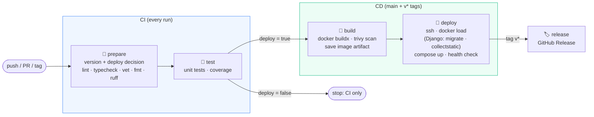
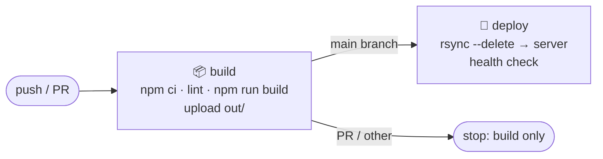
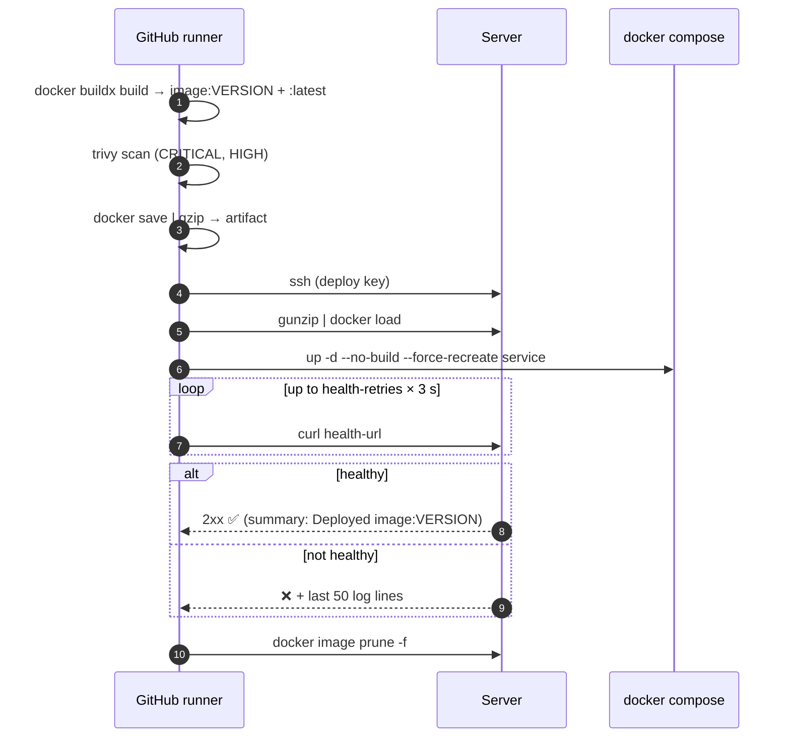

<p align="center">
  
</p>

<p align="center">
  
  
  
  
  
  
</p>

<p align="center">
  <b>One line in your repo → lint, test, build, scan, deploy over SSH, health-check and release.</b>
</p>

---

## 📚 Table of contents

- [What is this?](#-what-is-this)
- [Templates](#-templates)
- [How a pipeline flows](#-how-a-pipeline-flows)
- [What runs when](#-what-runs-when)
- [Quick start](#-quick-start)
  - [Go + Docker](#1-go--docker)
  - [Next.js + Docker](#2-nextjs--docker)
  - [Static site (Next.js export, Vite, …)](#3-static-site)
  - [Django + Docker](#4-django--docker)
- [Inputs reference](#-inputs-reference)
- [Secrets & variables](#-secrets--variables)
- [Server prerequisites](#-server-prerequisites)
- [Deploy under the hood](#-deploy-under-the-hood)
- [Versioning the templates](#-versioning-the-templates)
- [Troubleshooting](#-troubleshooting)
- [Roadmap](#-roadmap)

---

## 🧩 What is this?

`ci-templates` is a small library of **reusable GitHub Actions workflows** (`on: workflow_call`).
Each project keeps a tiny `deploy.yml` that calls a template, so the whole CI/CD logic lives in **one place**:
fix it here once, move the `v1` tag, and every project gets the fix.

```text
ci-templates/
└── .github/
    └── workflows/
        ├── go-docker.yml       # Go API  → Docker image → server (docker compose)
        ├── nextjs-docker.yml   # Next.js → Docker image → server (docker compose)
        ├── django-docker.yml   # Django  → Docker image → migrate → server (docker compose)
        └── static-site.yml     # Static build (out/) → rsync → server (nginx)
```

## 🗂 Templates

| Template | For | Build artifact | Deploy method | Tests | Security scan | Release |
|---|---|---|---|---|---|---|
| [`go-docker.yml`](.github/workflows/go-docker.yml) | Go services | Docker image | `docker load` + `docker compose up` | `go test` with Postgres 17 + Redis 8 services, coverage | Trivy | ✅ binaries for linux/amd64, linux/arm64, darwin/arm64 + checksums |
| [`nextjs-docker.yml`](.github/workflows/nextjs-docker.yml) | Next.js apps (`output: "standalone"`) | Docker image | `docker load` + `docker compose up` | `npm test --if-present` | Trivy | ✅ release notes |
| [`django-docker.yml`](.github/workflows/django-docker.yml) | Django apps (+ Celery) | Docker image | `docker load` + `migrate` + `collectstatic` + `docker compose up` | `manage.py check`, missing-migrations check, tests with Postgres 17 + Redis 8, coverage | Trivy | ✅ release notes |
| [`static-site.yml`](.github/workflows/static-site.yml) | Static sites (`output: "export"`, Vite, …) | `out/` folder | `rsync --delete` | lint | – | – |

## 🔄 How a pipeline flows

### Docker templates (Go / Next.js / Django)



### Static site template



## 🎯 What runs when

| Event | prepare / test | build | deploy | environment | release |
|---|:-:|:-:|:-:|---|:-:|
| Pull request | ✅ | – | – | – | – |
| Push to another branch | – (not triggered by default) | – | – | – | – |
| Push to `main` | ✅ | ✅ | ✅ | `dev` | – |
| Tag `v*` (e.g. `v1.2.0`) | ✅ | ✅ | ✅ | `production` | ✅ |
| Manual (`workflow_dispatch`) on `main` | ✅ | ✅ | ✅ | `dev` | – |

> [!TIP]
> Want tests on **every** branch push without deploying? Use `branches: ["**"]` in the caller.
> Deploy is still limited to `deploy-branch` (default `main`) and `v*` tags inside the template.

## 🚀 Quick start

Create `.github/workflows/deploy.yml` in your project and pick one of the following.

### 1. Go + Docker

```yaml
name: CI/CD

on:
  push:
    branches: [main]
    tags: ["v*"]
  pull_request:
  workflow_dispatch:

permissions:
  contents: write

jobs:
  pipeline:
    uses: ppeymann/ci-templates/.github/workflows/go-docker.yml@v1
    with:
      image: referendum
      app-dir: ~/referendum
      service: referendum-api
      health-url: http://127.0.0.1:8081/health
      go-main: ./cmd/app
    secrets: inherit
```

### 2. Next.js + Docker

```yaml
name: CI/CD

on:
  push:
    branches: [main]
    tags: ["v*"]
  pull_request:
  workflow_dispatch:

permissions:
  contents: write

jobs:
  pipeline:
    uses: ppeymann/ci-templates/.github/workflows/nextjs-docker.yml@v1
    with:
      image: referendum-fe
      app-dir: ~/referendum-fe
      service: referendum-fe
      health-url: http://127.0.0.1:3000/login
    secrets: inherit
```

> [!NOTE]
> The health check of this template accepts any HTTP code from `200` to `499`, so a page that
> redirects to `/login` or answers `401` still counts as "up".

### 3. Static site

```yaml
name: Deploy landing

on:
  push:
    branches: [main]
  pull_request:
  workflow_dispatch:

jobs:
  pipeline:
    uses: ppeymann/ci-templates/.github/workflows/static-site.yml@v1
    with:
      remote-dir: ~/landing/out
      health-url: http://127.0.0.1:8090
      build-env: |
        NEXT_PUBLIC_API_BASE_URL=${{ vars.NEXT_PUBLIC_API_BASE_URL }}
    secrets:
      SSH_HOST: ${{ secrets.SSH_HOST }}
      SSH_PORT: ${{ secrets.SSH_PORT }}
      SSH_USER: ${{ secrets.SSH_USER }}
      SSH_KEY: ${{ secrets.SSH_KEY }}
```

> [!IMPORTANT]
> `secrets: inherit` only works when the caller repo and `ci-templates` belong to the **same owner**.
> For a repo in another account or organization (e.g. `rojavagroup/*`), pass every secret explicitly as above.

### 4. Django + Docker

```yaml
name: CI/CD

on:
  push:
    branches: [main]
    tags: ["v*"]
  pull_request:
  workflow_dispatch:

permissions:
  contents: write

jobs:
  pipeline:
    uses: ppeymann/ci-templates/.github/workflows/django-docker.yml@v1
    with:
      image: my-backend
      app-dir: ~/backend
      services: web celery
      health-url: http://127.0.0.1:8000/admin/login/
      test-env: |
        DJANGO_SETTINGS_MODULE=config.settings
    secrets:
      SSH_HOST: ${{ secrets.SSH_HOST }}
      SSH_PORT: ${{ secrets.SSH_PORT }}
      SSH_USER: ${{ secrets.SSH_USER }}
      SSH_KEY: ${{ secrets.SSH_KEY }}
```

> [!NOTE]
> On deploy, `migrate` and `collectstatic` run in a one-off container of the **new** image
> (`docker compose run --rm --no-deps <migrate-service>`) **before** the services are recreated,
> so a failing migration stops the deploy and the old version keeps running.

## 📖 Inputs reference

<details open>
<summary><b>go-docker.yml</b></summary>

| Input | Type | Default | Required | Description |
|---|---|---|:-:|---|
| `image` | string | – | ✅ | Docker image name, e.g. `referendum` |
| `app-dir` | string | – | ✅ | Project dir on the server (holds `docker-compose.yml`) |
| `service` | string | – | ✅ | Compose service to recreate |
| `health-url` | string | – | ✅ | URL checked **from inside the server** (`curl -f`) |
| `go-main` | string | `./cmd/app` | | Main package for release binaries |
| `platform` | string | `linux/amd64` | | Image platform |
| `deploy-branch` | string | `main` | | Branch that auto-deploys to `dev` |
| `trivy-enabled` | boolean | `true` | | Scan the image with Trivy |
| `trivy-fail` | boolean | `false` | | Fail on HIGH/CRITICAL vulnerabilities |
| `release-enabled` | boolean | `true` | | Create a GitHub Release on `v*` tags |
| `health-retries` | number | `20` | | Health check attempts (3 s apart) |

The `test` job starts **Postgres 17** and **Redis 8** and exports
`DB_HOST`, `DB_PORT`, `DB_USER`, `DB_PASSWORD`, `DB_NAME`, `REDIS_ADDR` for your tests.
</details>

<details>
<summary><b>nextjs-docker.yml</b></summary>

| Input | Type | Default | Required | Description |
|---|---|---|:-:|---|
| `image` | string | – | ✅ | Docker image name |
| `app-dir` | string | – | ✅ | Project dir on the server |
| `service` | string | – | ✅ | Compose service to recreate |
| `health-url` | string | – | ✅ | URL checked from inside the server (200–499 = healthy) |
| `node-version` | string | `22` | | Node.js version |
| `platform` | string | `linux/amd64` | | Image platform |
| `deploy-branch` | string | `main` | | Branch that auto-deploys |
| `lint-enabled` | boolean | `true` | | `npm run lint --if-present` |
| `typecheck-enabled` | boolean | `true` | | `npm run typecheck --if-present` |
| `trivy-enabled` | boolean | `true` | | Scan the image with Trivy |
| `trivy-fail` | boolean | `false` | | Fail on HIGH/CRITICAL vulnerabilities |
| `release-enabled` | boolean | `true` | | GitHub Release on `v*` tags |
| `health-retries` | number | `20` | | Health check attempts (3 s apart) |
</details>

<details>
<summary><b>django-docker.yml</b></summary>

| Input | Type | Default | Required | Description |
|---|---|---|:-:|---|
| `image` | string | – | ✅ | Docker image name |
| `app-dir` | string | – | ✅ | Project dir on the server (holds `docker-compose.yml`) |
| `services` | string | – | ✅ | Compose services to recreate, space separated (`web celery celery-beat`) |
| `health-url` | string | – | ✅ | URL checked from inside the server (200–499 = healthy) |
| `migrate-service` | string | first of `services` | | Service used for `migrate` / `collectstatic` |
| `working-directory` | string | `.` | | Folder with `manage.py` and `Dockerfile` |
| `python-version` | string | `3.12` | | Python version in CI |
| `install-command` | string | `pip install -r requirements.txt` | | Dependency install in CI |
| `test-command` | string | `coverage run manage.py test` | | Test command (e.g. `coverage run -m pytest`) |
| `test-env` | string | `""` | | Extra `KEY=VALUE` lines for the test job |
| `manage-cmd` | string | `python manage.py` | | How `manage.py` is called inside the container |
| `lint-enabled` | boolean | `true` | | `ruff check` + `ruff format --check`, only if a ruff config exists |
| `migrate-enabled` | boolean | `true` | | Run `migrate --noinput` on deploy |
| `collectstatic-enabled` | boolean | `true` | | Run `collectstatic --noinput` on deploy |
| `platform` | string | `linux/amd64` | | Image platform |
| `deploy-branch` | string | `main` | | Branch that auto-deploys |
| `trivy-enabled` | boolean | `true` | | Scan the image with Trivy |
| `trivy-fail` | boolean | `false` | | Fail on HIGH/CRITICAL vulnerabilities |
| `release-enabled` | boolean | `true` | | GitHub Release on `v*` tags |
| `health-retries` | number | `20` | | Health check attempts (3 s apart) |

The `test` job starts **Postgres 17** and **Redis 8** and exports common names so most settings files work as-is:
`DATABASE_URL`, `DB_*`, `POSTGRES_*`, `REDIS_URL`, `CELERY_BROKER_URL`, `SECRET_KEY`, `DJANGO_SECRET_KEY` (dummy value), `DEBUG=False`.
</details>

<details>
<summary><b>static-site.yml</b></summary>

| Input | Type | Default | Required | Description |
|---|---|---|:-:|---|
| `remote-dir` | string | – | ✅ | Server folder that receives the build output |
| `health-url` | string | – | ✅ | URL checked from inside the server |
| `node-version` | string | `22` | | Node.js version |
| `build-command` | string | `npm run build` | | Build command |
| `out-dir` | string | `out` | | Build output folder |
| `build-env` | string | `""` | | `KEY=VALUE` lines added to the build environment |
| `lint-enabled` | boolean | `true` | | `npm run lint --if-present` |
| `deploy-branch` | string | `main` | | Branch that deploys |
</details>

## 🔐 Secrets & variables

Set them in **Settings → Secrets and variables → Actions** of each project repo.

| Name | Kind | Example | Used by |
|---|---|---|---|
| `SSH_HOST` | Secret | `203.0.113.10` | all |
| `SSH_PORT` | Secret | `22` | all |
| `SSH_USER` | Secret | `deploy` | all |
| `SSH_KEY` | Secret | contents of the **private** deploy key | all |
| `NEXT_PUBLIC_*` | Variable | `https://api.example.com` | static-site (via `build-env`) |

> [!CAUTION]
> Never commit keys or `.env` files. Copy the private key straight to the clipboard instead of printing it:
> `pbcopy < ~/.ssh/gh_actions` (macOS).

## 🖥 Server prerequisites

```bash
# 1. a dedicated deploy key (on your laptop)
ssh-keygen -t ed25519 -C "github-actions" -f ~/.ssh/gh_actions -N ""

# 2. authorize it on the server (-f: add it even if another key already works)
ssh-copy-id -f -i ~/.ssh/gh_actions.pub user@server

# 3. verify ONLY this key is used
ssh -F /dev/null -i ~/.ssh/gh_actions -o IdentitiesOnly=yes -o IdentityAgent=none user@server 'echo ok'
```

| Template | The server needs |
|---|---|
| Docker templates | Docker + Compose plugin, `app-dir` with a `docker-compose.yml` whose service uses `image: <image>:latest`, secrets in a `.env` (`chmod 600`) |
| Static site | `rsync`, a web server (e.g. `nginx:alpine` container) serving `remote-dir` |

Example static server (port `8090`):

```bash
docker run -d --name landing --restart unless-stopped -p 8090:80 \
  -v ~/landing/out:/usr/share/nginx/html:ro \
  -v ~/landing/default.conf:/etc/nginx/conf.d/default.conf:ro \
  nginx:alpine
```

## 🔬 Deploy under the hood



**Versions:** a `v*` tag becomes the image tag (`v1.2.0`); everything else becomes `sha-<7 chars>`.
`concurrency: deploy-<image>` makes sure two deploys of the same app never overlap.

## 🏷 Versioning the templates

Projects pin a **tag** (`@v1`). After changing a template, move the tag so callers pick it up:

```bash
git add . && git commit -m "fix: ..." && git push
git tag -f v1 && git push origin v1 --force
```

> [!WARNING]
> Moving `v1` updates **every** project on its next run. For breaking changes, create `v2`
> and migrate projects one by one.

## 🩺 Troubleshooting

| Symptom | Cause | Fix |
|---|---|---|
| Run fails in **0 s**, "workflow is not valid" | YAML indentation error in the template | Validate the YAML, push, move `v1` |
| "Unable to find reusable workflow" / can't read the file | File not pushed, `v1` not moved, wrong file name, or repo not accessible | Check `git ls-tree -r v1 --name-only`, match the name in `uses:` exactly, keep `ci-templates` public (or same owner) |
| `Secret SSH_HOST is required, but not provided` | `secrets: inherit` across different owners | Pass secrets explicitly |
| `Permission denied (publickey)` | Deploy public key not on the server | `ssh-copy-id -f -i ~/.ssh/gh_actions.pub user@server` |
| Push does not start the workflow | Branch is `master` but trigger is `main`, or no new commit | `git branch -m master main`, or `git commit --allow-empty -m "ci: retrigger"` |
| Health check fails | App can't reach DB/config, wrong port or path | Read the 50 log lines printed by the job; check `.env` and `health-url` |
| Django `check` / tests fail with `ImproperlyConfigured` | Settings need an env var CI doesn't set | Add it with `test-env` (e.g. `DJANGO_SETTINGS_MODULE=...`) |
| Deploy stops at **Migrate** | Migration error, or service not using `image: <image>:latest` | Read the job log; fix the migration; check `docker-compose.yml` |
| Static build has no API data | Backend unreachable at build time | Make sure the `NEXT_PUBLIC_*` URL answers from GitHub runners |

## 🗺 Roadmap

- [ ] `stage` environment for the `develop` branch
- [ ] Review apps per branch (Traefik + wildcard DNS)
- [ ] Push images to GHCR instead of shipping tarballs
- [ ] Coverage report on pull requests
- [ ] Rollback job (`image:previous`)

---

<p align="center">Made with ☕ by <a href="https://github.com/ppeymann">@ppeymann</a></p>
